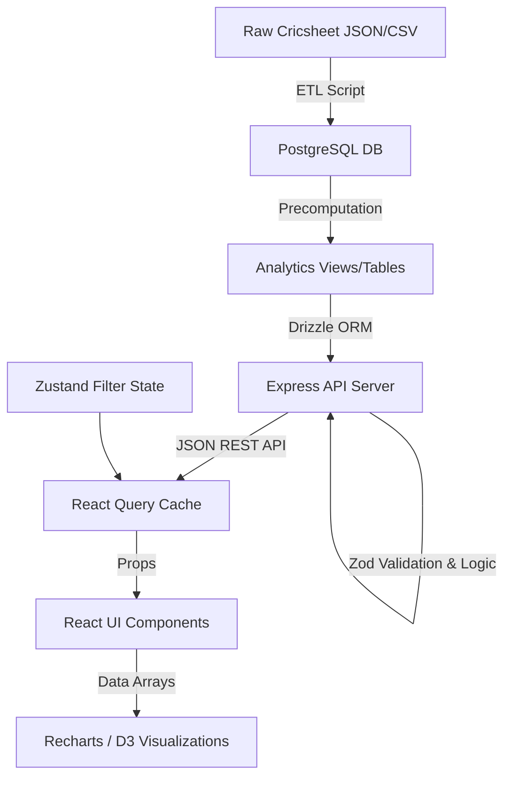

# DATA FLOW

## The Journey of a Cricket Delivery

### 1. Raw Dataset (Source)
- **Format**: JSON/CSV files from Cricsheet or similar providers.
- **Content**: Ball-by-ball text logs, player registries, and match outcomes.

### 2. Data Pipeline (Ingestion)
- **Action**: Node.js scripts (`artifacts/api-server/src/data/`) parse the raw files.
- **Transformation**: Maps raw strings ("caught", "bowled") into database enums. Calculates derived metrics immediately (e.g., `current_rr`, `required_rr`, `is_powerplay`, `pressure_state`).

### 3. Database (Storage)
- **Action**: Drizzle ORM executes batch inserts into PostgreSQL.
- **State**: The `deliveries` and `matches` tables are populated.
- **Precomputation**: Triggered scripts aggregate the new data into `player_career_stats` and update views.

### 4. API (Transport)
- **Action**: Frontend requests data via REST endpoints (e.g., `/api/v1/analytics/matchup?batter=X&bowler=Y`).
- **Processing**: Express routes pass the request to Services. Services use Drizzle to query the DB, applying any requested filters.

### 5. Services (Business Logic)
- **Validation**: Zod validates the incoming query parameters.
- **Computation**: If the data isn't precomputed, the service calculates the required metric on the fly (e.g., dynamic win probability adjustments).

### 6. State (Client Management)
- **Action**: React Query fetches the API response and caches it.
- **Global State**: Zustand updates global filters or context (e.g., "Active Season: 2026").

### 7. Components (UI Binding)
- **Action**: React components consume the React Query hooks. Data is passed down as props to presentation components.

### 8. Visualizations (Rendering)
- **Action**: Recharts/D3 receives the arrays of data objects and paints the SVG/Canvas on the screen, translating numbers into dynamic charts (e.g., Momentum graphs, Wagon wheels).

## Data Flow Diagram (Conceptual)

