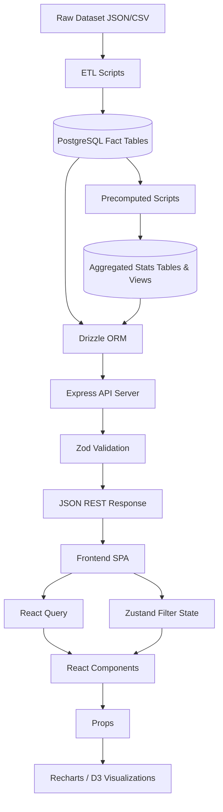

# MASTER ARCHITECTURE HANDBOOK: IPL Intelligence OS

This handbook serves as the single source of truth for the IPL Intelligence OS architecture. It is designed to be understood by Principal Architects, Data Engineers, and AI systems evaluating or contributing to the platform.

## Table of Contents

### Part I — Project Foundation
1. Project Overview
2. Folder Structure

### Part II — Application Architecture
3. Frontend Architecture
4. Backend Architecture
5. Database Architecture
6. Data Flow

### Part III — Analytical Engines
7. Analytics Engine
8. Filter Engine
9. Visualization Engine
10. Page Map

### Part IV — Engineering Stack
11. Tech Stack
12. Skills Matrix
13. Feature Matrix

### Part V — Architecture Review
14. Strengths
15. Gaps

### Part VI — Learning Guide
16. Self Study Guide

### Part VII — System Deep Dives
17. API Architecture
18. SQL Schema + Views
19. Roadmap

---

## Part I — Project Foundation

### 1. Project Overview

**Purpose & Vision**
The IPL Intelligence OS is an advanced sports analytics platform designed to ingest, process, and visualize ball-by-ball cricket data. Its vision is to translate highly granular transactional data (240+ deliveries per match) into actionable intelligence, predictive models (Win Probability), and visual storytelling (Momentum, Matchups) that go far beyond standard scorecards.

**Major Modules**
* **Data Pipeline & Ingestion**: Processes JSON/CSV datasets into relational tables.
* **Backend API**: Node.js/Express server delivering RESTful JSON endpoints.
* **Database Layer**: PostgreSQL with Drizzle ORM, managing fact tables and materialized views.
* **Frontend Web App**: React/Vite SPA utilizing Tailwind and Radix UI for interactive data exploration.
* **Analytics Engine**: SQL and Service-layer modules computing advanced metrics like Clutch Index.

**Development Stage**
Currently in the Integration and Advanced Analytics stage. Core infrastructure is stable; focus is currently on refining the Visualization Engine and AI-generated narratives.

### 2. Folder Structure

```text
Data-Insight-Engine/
├── artifacts/
│   ├── api-server/         # Backend API (Microservices / Service-Oriented Architecture)
│   ├── ipl-analytics/      # Frontend Web App (Component-Driven SPA)
│   └── image-ingestion/    # Microservice for static asset processing
├── lib/
│   ├── api-zod/            # Shared Zod schemas (End-to-End Type Safety)
│   ├── api-client-react/   # Shared API clients (DRY Principles)
│   └── db/                 # Database schema & migrations (Data Access Layer Abstraction)
└── docs/                   # Documentation blueprints
```

Every folder demonstrates strict separation of concerns, ensuring that database logic, HTTP transport, and UI rendering do not bleed into one another.

---

## Part II — Application Architecture

### 3. Frontend Architecture

The frontend (`artifacts/ipl-analytics/src`) follows a Component-Driven architecture using React, Vite, and Tailwind CSS.

* **Components (`/components`)**: Reusable UI building blocks constructed using Radix UI (Headless) and Tailwind. Designed using Atomic Design principles.
* **Pages (`/pages`)**: Route-level containers that orchestrate components and fetch data.
* **Hooks (`/hooks`)**: Custom logic encapsulation (`useFilters`, `useAnalytics`), separating UI from state logic.
* **Context/State**: Zustand handles global contextual state (e.g., Active Season), while React Query manages asynchronous server state and caching.
* **Services (`/lib`)**: API wrappers utilizing the shared `api-zod` definitions for type-safe network requests.
* **Visual Systems**: Recharts for cartesian grids, Canvas/D3 for spatial mapping (pitch heatmaps).

### 4. Backend Architecture

The backend (`artifacts/api-server/src`) follows a Layered Architecture (N-Tier) optimizing for read-heavy analytical queries.

* **Controllers / Routes (`/routes`)**: Define the HTTP API surface. Strictly responsible for param extraction and delegating to Services.
* **Services (`/services`)**: The core business logic. Calculates momentum, parses AI insights, and interacts with the DB. Independent of Express.
* **Middleware (`/middlewares`)**: Cross-cutting concerns like Pino logging, CORS, and Zod input validation.
* **Config & Data (`/data`)**: ETL logic for ingesting raw cricket datasets without blocking the main event loop.

### 5. Database Architecture

Built on PostgreSQL with Drizzle ORM.

* **Dimension Tables**: `teams`, `players`, `venues`, `seasons`. (Slowly changing metadata).
* **Fact Tables**: `matches`, `innings`, `deliveries`, `dismissals`. (`deliveries` is the core atomic unit of the entire system).
* **Relationships**: A match has many innings; an innings has many deliveries. Primary keys are auto-increment integers with indexed foreign keys for lightning-fast joins.
* **Views & Materialized Views**: Denormalized structures (e.g., `analytics_delivery_context`) join deliveries with player and match metadata, preventing expensive runtime joins for complex filters.

### 6. Data Flow



---

## Part III — Analytical Engines

### 7. Analytics Engine

* **Batting & Bowling Engine**: Computes standard aggregates (Average, Strike Rate, Economy) grouped by various dimensions (Season, Venue).
* **Venue Engine**: Analyzes pitch biases—calculating toss decision outcomes and first-innings winning scores.
* **Pressure & Clutch Engine**: Analyzes deliveries where `required_rr > 10` or `wickets_left < 4`. Outputs a `clutch_index` score.
* **Win Probability Engine**: A time-series model predicting the match outcome at any given delivery based on historical baselines.
* **Momentum Engine**: Tracks boundary frequency and wicket clusters in moving windows to visualize the "swing" of the game.

### 8. Filter Engine

* **Filter Hierarchy**: Global (Season, Match Type) -> Contextual (Team, Venue) -> Granular (Phase, Pressure State, Delivery Type).
* **Query Chaining**: Selected filters are serialized into URL parameters or Zustand state, then passed to React Query, which requests the API.
* **Cross-Filtering**: Selecting a "Team" restricts the "Player" dropdown options (requires tight API coupling).
* **State Management**: Drizzle ORM dynamically constructs SQL `WHERE` clauses (e.g., `eq(deliveries.phase, 'death')`) based on the validated Zod query object.

### 9. Visualization Engine

* **Charts (Recharts)**: Line and Area charts for Win Probability and Run Rate comparisons.
* **Heatmaps & Spatial (Canvas)**: Pitch maps highlighting where bowlers group deliveries.
* **Network Graphs (D3)**: Spider webs connecting specific batters to the bowlers who dismiss them most frequently.
* **Telemetry Views**: Time-series dashboards used in the "Pulse" page to show momentum shifts.
* **Sankey Diagrams (D3)**: Flow of runs from Bowler -> Pitch Zone -> Batter -> Fielding Position.

### 10. Page Map

* **Home / Feed**: Live match scores and social-style AI insights. (Data Source: `/api/matches/recent`, `/api/feed`).
* **Match Explorer**: Deep dive into a specific match with a ball-by-ball timeline and phase filters. (Data Source: `/api/matches/:id/deliveries`).
* **Pulse**: The dramatic narrative view of Win Probability and Momentum charts. (Data Source: `/api/analytics/pulse`).
* **Stats Hub**: Traditional tabular statistics using sortable data tables. (Data Source: `/api/stats/players`).
* **Matchup Explorer**: (new) Player-search entry point into head-to-head batter vs bowler records — quick-picks, search-by-name, sortable balls/SR/average/dismissals table. Lives inside Stats Hub as the plain-language front door to matchup data. (Data Source: `/api/analytics/matchup`, no cross-filters).
* **Intel**: Pro-level tool for deep matchup analysis and heatmaps, layering phase/venue/season cross-filters and D3 network graphs on top of the same data the Matchup Explorer shows. (Data Source: `/api/analytics/matchup`, cross-filtered).
* **Reports**: Exportable intelligence queries (PDF/CSV).

---

## Part IV — Engineering Stack

### 11. Tech Stack

| Category | Technology | Purpose & Capability |
| :--- | :--- | :--- |
| **Frontend** | React, Vite, TypeScript | Fast, type-safe SPA architecture and component rendering. |
| **Styling/UI** | Tailwind CSS, Radix UI | Rapid utility styling combined with accessible headless primitives. |
| **Backend** | Node.js, Express.js | Non-blocking HTTP server optimized for JSON payload delivery. |
| **Database** | PostgreSQL | Robust relational storage with advanced window function capabilities. |
| **ORM & Validation** | Drizzle ORM, Zod | End-to-end type safety from the database schema to the UI props. |
| **Visualization** | Recharts, D3.js | Transforming complex arrays into interactive SVG/Canvas charts. |

### 12. Skills Matrix

| Engineering Implementation | Demonstrated Engineering Skill |
| :--- | :--- |
| Normalization of deliveries and matches | Relational Database Design |
| Materialized Views for clutch_index | Advanced SQL Analytics & Query Optimization |
| Zod & Drizzle Shared Types | Type-Safe Fullstack Engineering |
| Cricsheet JSON Parsing Scripts | Data Engineering & ETL |
| Recharts Win Probability Graphs | Advanced Data Visualization |
| pnpm-workspace.yaml | Monorepo Configuration |

### 13. Feature Matrix

| Feature | Files | Technologies | Purpose | Engineering Concept |
| :--- | :--- | :--- | :--- | :--- |
| **Win Probability** | `probabilityEngine.ts` | TS + Math Models | Predict live match outcomes. | Predictive Analytics / Time Series |
| **Momentum Tracker** | `momentum_tracker` | SQL + Node.js | Visualize shifts in match control. | Moving Averages / Streaming Data |
| **Clutch Index** | `clutch_index` | SQL Window Functions | Identify players who perform under pressure. | Weighted Aggregations |
| **Filter Engine** | `useFilters.ts` | Zustand + Drizzle | Allow deep slicing of massive datasets. | Dynamic Query Construction |
| **Matchup Explorer** | `batter_bowler_matchup_stats`, `MatchupExplorer.tsx` | SQL Materialized View + React Query | Head-to-head batter vs bowler records from raw deliveries. | Grouped Aggregation / Minimum-Sample Filtering |

---

## Part V — Architecture Review

### 14. Strengths

* **Type-Safe Monorepo**: Changing a column in the database immediately flags TypeScript errors in the frontend React components.
* **Precomputed Aggregations**: Heavy analytics are stored in precomputed tables (`player_career_stats`), ensuring sub-100ms API responses instead of calculating metrics across millions of rows at runtime.
* **Headless UI Architecture**: Radix UI paired with Tailwind separates behavioral state (a11y, focus trapping) from visual styling.
* **Domain-Driven Design**: The database models exact cricket concepts (`is_powerplay`, `scoring_area`) rather than generic sports primitives.

### 15. Gaps & Technical Debt

* **Frontend Aggregations**: Some advanced metrics are calculated via `array.reduce()` on the frontend after fetching large datasets, which can cause UI stutter.
* **Duplicate Datasets**: Raw CSV files exist alongside the PostgreSQL database, risking split sources of truth.
* **Redundant APIs**: Overlapping REST endpoints (e.g., `/api/stats` vs `/api/analytics`) lead to duplicated React Query caches and confusion. (Partially resolved for matchups — `/api/matchups` and `/api/analytics/matchup` collapsed into one canonical route, §17. The broader `/api/stats` vs `/api/analytics` overlap elsewhere is still open.)
* **Broken Filters**: Mutually exclusive filter combinations (e.g., "Pace Bowler" + "Leg Spin Delivery") do not cascade or warn the user, leading to empty states.

---

## Part VI — Learning Guide

### 16. Self Study Guide

**1. The Monorepo Root (`/`)**
* **What is it?** The top-level folder holding everything together via pnpm workspaces.
* **Why does it exist?** To let frontend, backend, and database code live together and share tools easily.
* **What happens if removed?** The apps wouldn't know how to talk to each other or resolve dependencies.
* **Skill**: Monorepo Architecture.

**2. Database Layer (`lib/db`)**
* **What is it?** Defines the PostgreSQL database using Drizzle ORM.
* **Why does it exist?** Acts as the blueprint for our data using TypeScript objects instead of raw SQL strings.
* **What happens if removed?** The API server crashes due to missing database connection and query logic.
* **Skill**: Database Modeling.

**3. Backend API (`artifacts/api-server`)**
* **What is it?** A Node.js/Express server acting as the middleman between the Database and the Frontend.
* **Why does it exist?** Securely fetches, filters, and processes data before sending it to the user.
* **What happens if removed?** The frontend UI would have zero data.
* **Skill**: Backend API Engineering.

**4. Frontend App (`artifacts/ipl-analytics`)**
* **What is it?** The React/Vite/Tailwind website the user sees.
* **Why does it exist?** Provides an interactive dashboard to explore the data visually.
* **What happens if removed?** There is no product for the user to interact with.
* **Skill**: Frontend UI/UX Engineering.

---

## Part VII — System Deep Dives

### 17. API Architecture

The backend exposes resource-oriented and analytical REST endpoints.

**/api/stats**
* **Purpose**: Traditional statistical aggregations.
* **Example Request**: `GET /api/stats/players?season=2024&limit=10`
* **Example Response**: `[{ "player_id": 1, "name": "V. Kohli", "runs": 741, "strike_rate": 154.6 }]`

**/api/analytics/matchup** (canonical — replaces the old `/api/matchups` route, resolving the Redundant APIs gap in §15)
* **Purpose**: Deep head-to-head analysis between specific players, backed by the `batter_bowler_matchup_stats` materialized view (§18). Serves both the Intel page's cross-filtered explorer and any lightweight single-pair lookup, so there is exactly one matchup data path.
* **Example Requests**:
  * `GET /api/analytics/matchup?batter_id=1` → every bowler that batter has faced, sorted by balls faced (drives the quick-pick / player-search matchup view)
  * `GET /api/analytics/matchup?batter_id=1&bowler_id=5` → the specific pair
  * `GET /api/analytics/matchup?batter_id=1&bowler_id=5&phase=death&season=2024` → cross-filtered (Intel page)
* **Example Response**: `[{ "batter_id": 1, "bowler_id": 5, "balls": 30, "runs": 45, "dismissals": 2, "strike_rate": 150.0, "average": 22.5, "dot_percentage": 33.3 }]`
* **Guardrail**: rows below a minimum-sample threshold (default 6 balls) are excluded server-side, not filtered client-side — keeps small-sample noise out of both the Matchup Explorer and Intel views consistently.

**/api/scenario**
* **Purpose**: Fetching stateful Win Probability and Momentum based on dynamic game states.
* **Example Request**: `GET /api/scenario/win-probability?target=180&current_score=120&wickets=3&overs=15`
* **Example Response**: `[{ "chasing_team_win_prob": 68.5, "defending_team_win_prob": 31.5 }]`

**/api/teams & /api/players**
* **Purpose**: Metadata and profiles.
* **Example Request**: `GET /api/players/1/intel`
* **Example Response**: `[{ "clutch_index": 8.4, "weakness": "Left-arm pace in death overs" }]`

### 18. SQL Schema + Views

Because the system deals with ball-by-ball granularity, the SQL architecture is highly specific:

**Tables**:
* `matches` (grain: 1 row per match)
* `deliveries` (grain: 1 row per legal/illegal delivery. ~240 rows per match). This is the heaviest table and the source of truth for all analytics.
* `clutch_index` (grain: 1 row per player, updated dynamically).

**Indexes**:
* Composite indexes on `deliveries(match_id, innings_id)` and `deliveries(batter_id, bowler_id)` to speed up Matchup and Explorer queries.

**Views & Materialized Views**:
* `analytics_delivery_context`: A View that joins `deliveries` with `matches` and `teams`. Used by the Filter Engine to avoid writing complex `JOIN` logic in the ORM repeatedly.

**Aggregation Tables**:
* `player_phase_stats`: Precomputed aggregations of runs/wickets split by Powerplay, Middle, and Death overs. This prevents calculating `SUM(runs)` across millions of rows for basic UI rendering.
* `batter_bowler_matchup_stats` (new — backs `/api/analytics/matchup`): Materialized view grouping deliveries (joined to dismissals on `player_out_id`) by (`batter_id`, `bowler_id`), with an optional phase grouping column so the same view serves both the plain Matchup Explorer and Intel's phase-filtered queries. `HAVING COUNT(*) >= 6` enforces the minimum-sample guardrail described in §17. Refreshed via `REFRESH MATERIALIZED VIEW CONCURRENTLY` at the end of each ingest run, same as `clutch_index`.
  * **Supporting index**: composite `deliveries(batter_id, bowler_id)` already covers the join; add `dismissals(player_out_id)` if not already indexed, since the view's dismissal count depends on it.

### 19. Roadmap

To prevent over-engineering, the project is structured against a strict roadmap.

* **Current**: Core Stats, Dashboard UI, Data Ingestion Pipeline, Win Probability baseline, and a consolidated Matchup Explorer (single `/api/analytics/matchup` route serving both the plain explorer and Intel's cross-filtered view).
* **Next**: Bowler-type metadata (pace/spin, arm) on the `players` table — not present in Cricsheet, needs hand-curation or a secondary source — to unlock "struggles against left-arm spin" style breakdowns. Advanced Predictive Modelling for matchups, Deep Venue Analysis, and Cascading Filters to fix UI gaps. Consolidating the remaining `/api/stats` vs `/api/analytics` overlap.
* **Future**: Real-time pulse data processing from live game streams via WebSockets. Advanced AI narrative generation for match recaps.
* **Experimental**: Generative UI integration—allowing users to type "Show me Kohli's stats against Rashid in the 19th over" and having an LLM generate the Drizzle SQL query and render a custom chart dynamically.
