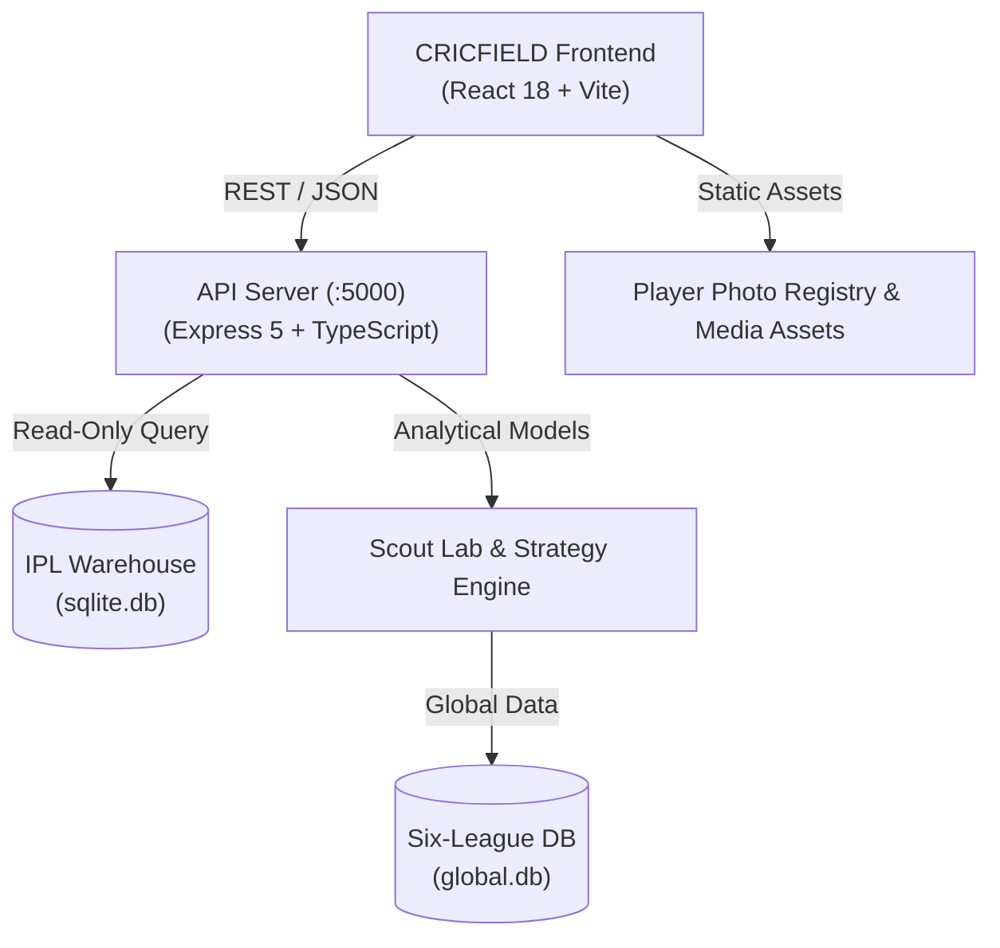

# CRICFIELD — IPL ANALYTICAL ENGINE
> **"IPL is not cricket. It is a product, a media empire, and an economic ecosystem."**

An enterprise-grade sports intelligence, analytical calculations, and decision-support platform for the Indian Premier League (IPL). Built with 19 seasons of granular ball-by-ball delivery data, multi-tiered scouting models, interactive stadium telemetry, and real-time predictive simulations.

[](LICENSE)
[](package.json)
[](artifacts/ipl-analytics/package.json)
[](artifacts/ipl-analytics/vite.config.ts)
[](artifacts/api-server/package.json)
[](schema.sql)

---

## 1. Project Overview

CRICFIELD transforms raw cricket delivery records into deep actionable intelligence. It powers player evaluations, squad compositions, match-scenario simulations, auction strategy rooms, and cinematic match centers.

The system serves both modern analytical operators (franchise scouts, analysts, tacticians) and public cricket fans through high-performance desktop and responsive mobile interfaces.

---

## 2. Branding & Identity

- **Platform Name:** CRICFIELD
- **Sub-Engine:** IPL ANALYTICAL ENGINE
- **Tagline:** Intelligence & Decision Architecture for Professional Cricket
- **Design Language:** Cinematic dark stadium palette, franchise color tokens, high-density telemetry grids, and responsive data cards.

---

## 3. Major Platform Features

### A. Intelligence & Match Analytics
- **Ball-by-Ball Warehouse:** Comprehensive delivery commentary, phases (Powerplay, Middle, Death), ball types, and pressure metrics across 19 IPL seasons (2008–2026).
- **Match Center & Replay:** Ball context, momentum index, win probability charts, and interactive delivery maps.
- **Cinematic Dugout:** Franchise intelligence hubs, head-to-head rivalry records, and squad timelines.

### B. Scout Lab & Player Evaluation
- **Global Data Engine:** Six-league scouting database (IPL, BBL, PSL, CPL, SA20, The Hundred) powered by SQLite and statistical engines.
- **Player Profiles & DNA:** Batter/bowler radar charts, phase splits, boundary percentages, and matchup matrices.
- **Player Photo Registry:** Centralized, multi-alias indexed player portrait pipeline with official jersey representations.

### C. Decision & Auction War Room
- **Auction Strategy Simulator:** Linear programming optimization (`javascript-lp-solver`) for squad budget allocations and player valuations.
- **Playing XI Optimizer:** Tactical depth calculators, bowler quota validations, and squad composition balance ratings.
- **Retention Room:** Franchise retention matrices, price tier allocations, and purse tracker.

### D. Fan Arena & CricArcade
- **Interactive Challenges:** Cricket tactical decision games, scenario forecasts, and interactive fan engagement.

---

## 4. Technology Stack (Verified from Source)

| Tier | Technology | Version / Notes |
| :--- | :--- | :--- |
| **Frontend Framework** | React 18 | `react`, `react-dom` (React 18.3) |
| **Build Tool & Bundler** | Vite | Vite 6 with custom route splitting & alias resolution |
| **Styling & Design** | Tailwind CSS v4 | `@tailwindcss/vite`, Radix UI primitives, Lucide React icons |
| **Visualizations** | Recharts & Canvas | High-performance SVG charts, heatmaps, and spatial ground deck |
| **Backend API** | Node.js / Express 5 | TypeScript REST API with Pino structured logging |
| **Database & ORM** | SQLite / Drizzle ORM | Native `node:sqlite` in read-only production mode + Drizzle ORM |
| **Optimization Solvers** | `javascript-lp-solver` | Linear programming auction solver for roster construction |
| **Package Manager** | pnpm Workspaces | Monorepo structured with `pnpm@11.1.2` (`artifacts/*`, `lib/*`, `scripts`) |
| **Language** | TypeScript 5.9 | Strict type checking across monorepo packages |

---

## 5. Project Architecture



The monorepo is split into distinct concerns:
- **`artifacts/ipl-analytics/`**: Responsive web application client.
- **`artifacts/api-server/`**: Express REST API server providing intelligence, player data, and auction simulations.
- **`lib/db/`**: Drizzle schema definitions and database client connectors.
- **`lib/cricket-data/`**: Processed global league datasets and warehouse models.
- **`scripts/`**: Data ingestion, checksum verification, and release automation tools.
- **`data-release/`**: Checksummed dataset release packages.

---

## 6. Installation & Prerequisites

### Prerequisites
- **Node.js:** `>= 24.0.0 < 25.0.0`
- **pnpm:** `11.1.2`
- **Git & Git LFS:** `git-lfs` (required for repository binary tracking)

### Clone & Setup
```bash
git clone https://github.com/CRICFIELD-INTELLIGENGE/IPL-ANALYTICAL-ENGINE.git
cd IPL-ANALYTICAL-ENGINE

# Ensure Git LFS pulls warehouse databases
git lfs pull

# Install all workspace dependencies
pnpm install
```

---

## 7. Environment Setup

Create an environment configuration file for the frontend:

```bash
cp artifacts/ipl-analytics/.env.example artifacts/ipl-analytics/.env.local
```

Populate the required ports and variables:
```env
# Backend API Port
VITE_BACKEND_PORT=5000

# Base URL Path
BASE_PATH=/
```

---

## 8. Development Commands

### Windows One-Click Launcher
Run the root batch file:
```cmd
START-CRICFIELD.bat
```
This starts both the API server on `http://localhost:5000` (read-only SQLite mode) and the frontend on `http://localhost:3000`.

### Manual Workspace Commands
```bash
# Start API Server (:5000)
pnpm --filter @workspace/api-server run dev

# Start Frontend Client (:3000)
pnpm --filter @workspace/ipl-analytics run dev
```

---

## 9. Build Commands

```bash
# Typecheck entire workspace
pnpm run typecheck

# Build frontend production bundle
pnpm --filter @workspace/ipl-analytics run build

# Build backend API production distribution
pnpm --filter @workspace/api-server run build
```

The compiled frontend output is placed in `artifacts/ipl-analytics/dist/public/`.

---

## 10. Testing & Verification

```bash
# Run backend test suite
pnpm --filter @workspace/api-server run test

# Verify cricket datasets integrity
node scripts/data-release.mjs verify data-release/cricfield-data-2026.10.14
```

---

## 11. Data Sources & Provenance

- **Cricsheet Data:** Ball-by-ball matches sourced from [Cricsheet](https://cricsheet.org/) under the Open Data Commons Attribution License (ODC-BY 1.0).
- **IPL Match Coverage:** 1,243 IPL match files with standardized delivery indexes (`actual_delivery`).
- **Warehouse Corrections:** Standardized dismissal definitions (retired-out vs retired-hurt), penalty run accounting, extras taxonomy, and super-over resolutions (Day 4.5 integrity specifications).

---

## 12. Deployment Instructions

### Vercel (Frontend & Analytics UI)
The repository includes an optimized root `vercel.json` configured for pnpm builds:
1. Connect this repository to your Vercel organization account.
2. Root Directory: `./`
3. Output Directory: `artifacts/ipl-analytics/dist/public`
4. Custom Domain: Configure `cricfield.in` in Vercel project domain settings.

### API Server (Docker / Linux Server)
The API server can be executed in production with Node.js 24+:
```bash
cd artifacts/api-server
set PORT=5000
set CRICFIELD_DB_READONLY=1
node --enable-source-maps ./dist/index.mjs
```

---

## 13. Security Considerations

- **Secrets Handling:** Private environment files (`.env`, `.env.*`, `env/*.env`) are strictly excluded via `.gitignore`.
- **Database Access:** Production servers operate against `sqlite.db` strictly in read-only mode (`CRICFIELD_DB_READONLY=1`). Schema mutations are blocked by Drizzle production guards.
- **Reporting:** Please review [SECURITY.md](SECURITY.md) for vulnerability disclosure guidelines.

---

## 14. Contribution Guidelines

See [CONTRIBUTING.md](CONTRIBUTING.md) for code styling, pull request workflows, and dataset preservation policies.

---

## 15. Repository Structure

```
IPL-ANALYTICAL-ENGINE/
├── artifacts/
│   ├── api-server/             # Express 5 REST API & Decision Services
│   ├── image-ingestion/        # Player photograph extraction & processing
│   └── ipl-analytics/          # React 18 / Vite / Tailwind UI Application
├── data-release/               # Versioned, checksummed dataset snapshots
├── docs/                       # Architecture handbooks, data repair reports, launch audits
├── lib/
│   ├── api-zod/                # Shared Zod validation schemas
│   ├── arcade-rules/           # CricArcade game rules & scoring
│   ├── cricket-data/           # Six-league datasets and manifests
│   └── db/                     # Drizzle ORM schema & SQLite config
├── scripts/                    # Data maintenance, verification, and ingestion scripts
├── attached_assets/            # Design specifications and architecture blueprints
├── schema.sql                  # Comprehensive SQLite warehouse schema
├── START-CRICFIELD.bat         # Windows dual-server development launcher
├── vercel.json                 # Vercel deployment configuration
├── .gitattributes              # Git LFS & line ending definitions
├── .gitignore                  # Enterprise ignore rules (secrets & temp caches)
└── package.json                # Monorepo workspace configuration (pnpm)
```

---

## License

This project is licensed under the MIT License — see the [LICENSE](LICENSE) file for details.  
Match data is attributed to [Cricsheet](https://cricsheet.org/) under [ODC-BY 1.0](https://opendatacommons.org/licenses/by/1-0/).
