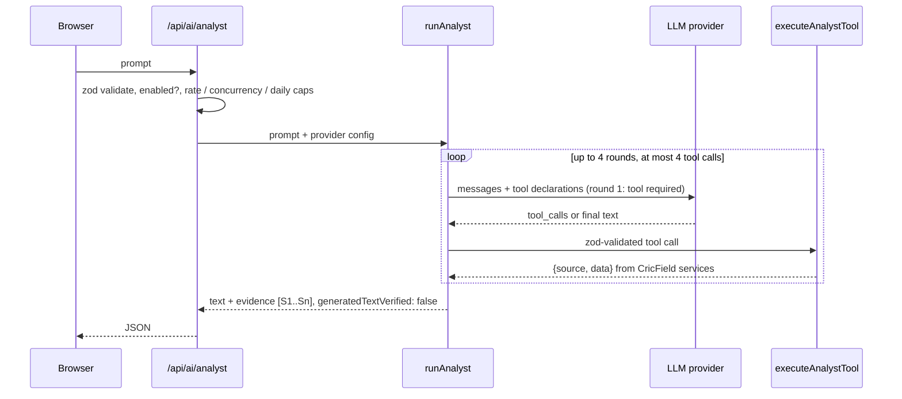

# AI Analyst

The AI Analyst answers cricket questions in natural language using **only** evidence returned by CricField tools. It is **off by default** and does not run on the static production site.

Code: route in `artifacts/api-server/src/routes/ai-analyst.ts`, tool loop in `services/cricfield-analyst.ts`, providers in `services/ai-provider.ts`, `groq.ts`, `ollama.ts`, `openrouter.ts`. Scout AI uses `services/scout-conversation.ts`.

## Endpoints

| Endpoint | Input | Limits |
|---|---|---|
| `POST /api/ai/analyst` | `{ prompt }`, 3–2000 chars, strict | 5 per minute per client; at most 2 concurrent; daily cap `AI_ANALYST_DAILY_LIMIT` (default 100) |
| `POST /api/scout/analyst` | `{ prompt (≤1500), team?, history? }` | Same limits, shared counters |
| `GET /api/scout/analyst/status` | none | Reports whether AI and web search are enabled and which provider is configured |

The analyst answers 503 unless `AI_ANALYST_ENABLED=true` **and** a provider is configured. It answers 429 when busy or over the daily cap. It answers 502 when no evidence-backed answer could be produced; no unverified text is substituted.

## Providers (`aiConfig()`)

`AI_PROVIDER` selects the provider. When it is unset, the default is `openrouter` in production and `ollama` otherwise.

| Provider | Needs |
|---|---|
| `ollama` | `OLLAMA_BASE_URL`, `OLLAMA_MODEL` (local) |
| `openrouter` | `OPENROUTER_API_KEY`, `OPENROUTER_MODEL` |
| `groq` | `GROQ_API_KEY`, `GROQ_MODEL` |
| `cloudflare` | `CLOUDFLARE_API_TOKEN`, `CLOUDFLARE_ACCOUNT_ID` (32 hex), `CLOUDFLARE_AI_MODEL` (`@cf/...`) |

All keys are server-only. Never prefix them with `VITE_`.

## How an answer is produced

- **Tools** (`analystToolSchema`): `statistics` (NL question → `nl-parser` + `stats-engine`, same as `/api/ask`), `player_summary`, `auction_records`, `player_valuation`, `franchise_need`, `best_value`, `squad_scenario`, `replacement_options`, `retention_picks`, `retention_forecast`, `retention_dilemmas`, `retention_fans`.
- **Guards:** a 25-second timeout, 4000-character tool arguments, 60,000-character evidence per tool, and a final text that must come with at least one evidence item. The system prompt forbids inventing statistics, sales or live events. A separate rule says prices, probabilities and values may only be quoted from tool results.
- **Ollama path:** local models do not get a tool loop. A regex router picks one tool from the question wording. The model explains that single result within 90 seconds. If the model fails, a plain warehouse answer is returned, prefixed "Warehouse answer (local AI explanation unavailable)".
- Every reply carries `generatedTextVerified: false`. The evidence is real, but the prose is not checked.

## Related flags

`AI_COMMENTARY_ENABLED` + `AI_DAILY_REQUEST_LIMIT` (AI ball commentary and its daily cap, `routes/ai-commentary.ts`), and `SCOUT_WEB_SEARCH_ENABLED` + `SERPAPI_API_KEY` (optional web evidence for Scout AI).

## Status

- **Implemented:** the endpoints, tool loop, four providers and tests (`test/cricfield-analyst.test.ts`, `cloudflare-ai.test.ts`, `ollama.test.ts`, `openrouter.test.ts`, `scout-conversation.test.ts`).
- **Not live in production:** Vercel serves no API, so the Ask pages need a separately hosted API to answer.
