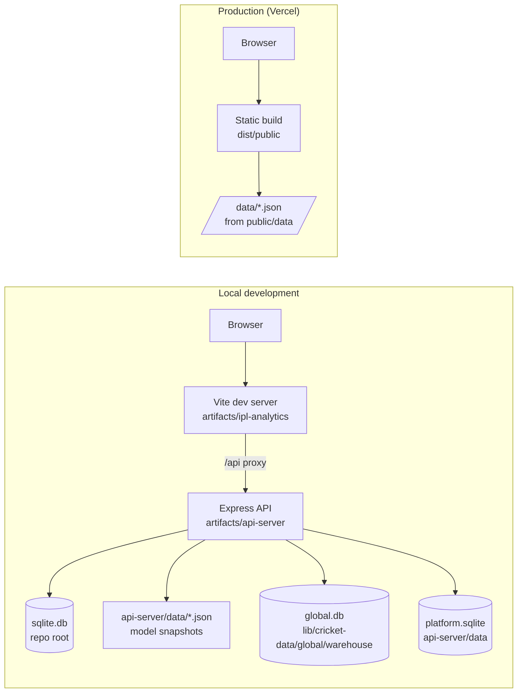
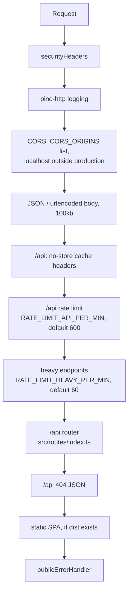

# Architecture

CricField is a pnpm workspace with three parts:

| Identity | What it is | Where it lives |
|---|---|---|
| **CricField product** | The website at https://www.cricfield.in (React SPA) | `artifacts/ipl-analytics` |
| **Analytics engine** | Express API with the models (decision, intelligence, pressure, retention, scout, arcade) | `artifacts/api-server`, `lib/arcade-rules` |
| **Cricket data pipeline** | Scripts that build the warehouses and the JSON the site reads | `scripts/`, `lib/cricket-data/`, `artifacts/api-server/scripts/` |

Shared libraries: `lib/db` (SQLite client for `sqlite.db`), `lib/api-spec` (OpenAPI spec plus codegen), `lib/api-zod` and `lib/api-client-react` (generated from the spec).

## Runtime: development vs production

- **Production is static.** `vercel.json` builds only `@workspace/ipl-analytics`, serves `artifacts/ipl-analytics/dist/public`, and rewrites every path to `/index.html`. No API runs there, so `/api/*` returns the SPA's HTML.
- **Static fallback.** The frontend loader in `artifacts/ipl-analytics/src/lib/aggregates.ts` (`fetchJson`) calls `/api/ipl/<name>` first. If the call fails or the response is HTML, it loads `/data/<name>.json` instead. Features with no static JSON copy only work when the API is running.
- **The API can also serve the SPA.** `artifacts/api-server/src/app.ts` serves `../../ipl-analytics/dist/public` when that folder exists. It warns when the built `data/` differs from `public/data/`.

## API request path (`artifacts/api-server/src/app.ts`)

Admin-only writes use `requireAdmin` from `src/lib/admin-auth.ts`, which checks `ADMIN_API_TOKEN`. The full table is in [API_REFERENCE.md](API_REFERENCE.md).

## Workspace packages

| Package | Path | Role |
|---|---|---|
| `@workspace/ipl-analytics` | `artifacts/ipl-analytics` | Product SPA (React 19.1, Vite 7, Tailwind 4, wouter, TanStack Query, Recharts). The mobile shell in `src/mobile` loads below 1024px. |
| `@workspace/api-server` | `artifacts/api-server` | Express 5 API on `node:sqlite`, pino logging, esbuild bundle (`build.mjs`) |
| `@workspace/mockup-sandbox` | `artifacts/mockup-sandbox` | Standalone Vite design sandbox; nothing imports it |
| `@workspace/db` | `lib/db` | `node:sqlite` client plus a Drizzle `sqlite-proxy` over `sqlite.db` |
| `@workspace/api-spec` | `lib/api-spec` | OpenAPI spec and Orval codegen |
| `@workspace/api-zod`, `@workspace/api-client-react` | `lib/api-zod`, `lib/api-client-react` | Generated validators and React Query client |
| `@workspace/arcade-rules` | `lib/arcade-rules` | Game rules shared by the API and the web app |
| `@workspace/scripts` | `scripts` | Data pipeline commands (see [DATA_PIPELINE.md](DATA_PIPELINE.md)) |

`artifacts/image-ingestion` has no `package.json`. It is the output folder of the Python tool in `scripts/image_ingestion`.

## API services (`artifacts/api-server/src/services`)

| Folder / file | Purpose |
|---|---|
| `stats-aggregator.ts`, `team-analytics.ts`, `insights.ts`, `match-card.ts` | Warehouse statistics, scenario stats, match cards |
| `decision/` | Decision Intelligence: NL stat questions, playing XI, strategy simulator, alternate universe, opposition map, squad DNA, auction war room (see [SCENARIO_INTELLIGENCE.md](SCENARIO_INTELLIGENCE.md)) |
| `intelligence/` | Player Intelligence: price, value, fit and squad optimiser, served from published snapshots |
| `pressure/` | Pressure Reliability model, engine and reliability |
| `retention/` | Retention Room: CRR picks, trade ledger, forecast |
| `scout/`, `scout-*.ts` | Multi-league scouting over `global.db` |
| `cricfield-analyst.ts`, `ai-provider.ts`, `groq.ts`, `ollama.ts`, `openrouter.ts` | AI Analyst tool loop (see [AI_ANALYST.md](AI_ANALYST.md)) |
| `arcade/` | Arcade rooms, live match and live auction state |
| `platform/` | Notifications, auth verification, delivery worker, analytics events |
| `video/` | Video catalogue and clip sync |
