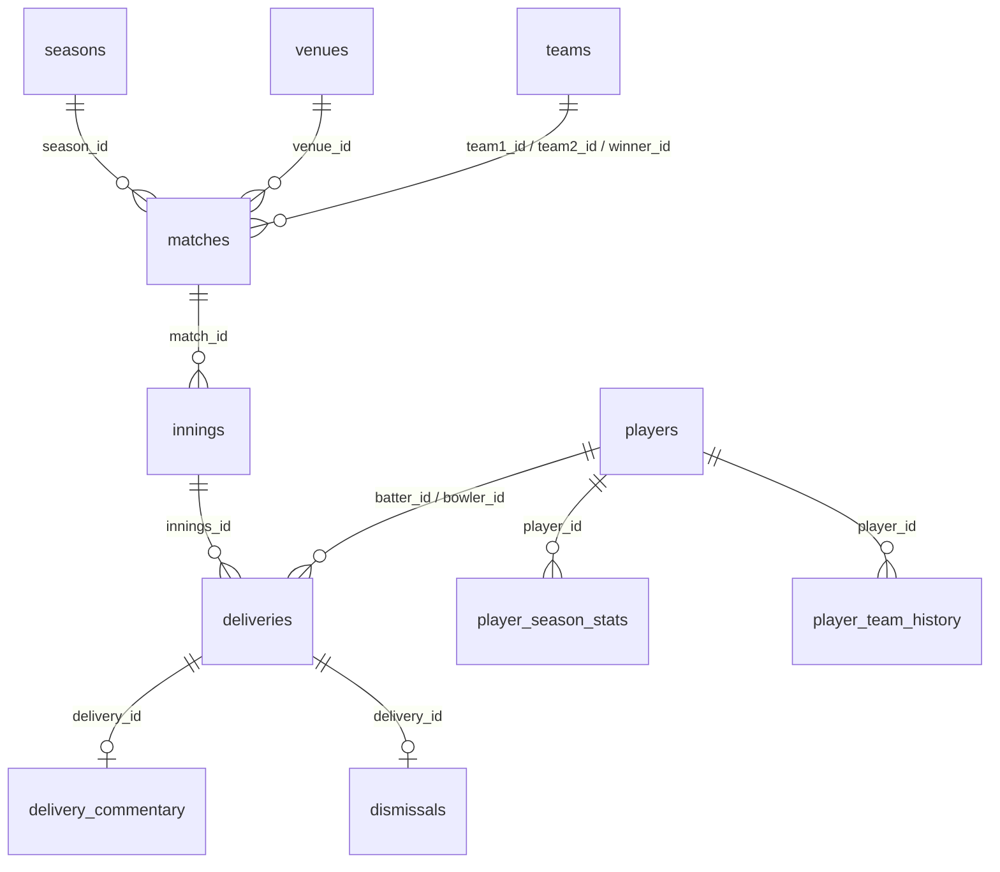

# Databases

All databases are SQLite, opened with Node's built-in `node:sqlite` (`DatabaseSync`). Row counts below were read on 2026-11-16 from read-only copies.

| Store | Path | In git? | Opened by |
|---|---|---|---|
| IPL warehouse | `sqlite.db` (repo root, about 111 MB) | No (`/sqlite.db` ignored) | `lib/db/src/index.ts` |
| Global multi-league warehouse | `lib/cricket-data/global/warehouse/global.db` (about 155 MB) | No | `scripts/src/global/db.ts` (builds), `artifacts/api-server/src/services/scout/db.ts` (reads; override with `CRICFIELD_SCOUT_DB_PATH`) |
| Platform state (notifications, analytics events) | `<cwd>/data/platform.sqlite`, override with `PLATFORM_DB_PATH` | No | `services/platform/store.ts` |
| `data/platform.sqlite` (+ `-wal`, `-shm`) | repo root `data/` | **Yes**, although `.gitignore` names it | Created when the API runs with the repo root as its working directory (the default path is cwd-relative) |
| `data/ipl.db` | repo root `data/` | **Yes**, 0 bytes | No code reference found |
| `artifacts/api-server/data/decision.db` | | No, 0 bytes locally | No code reference found. `services/decision/db.ts` opens `sqlite.db` read-only. |

When the API is started from `artifacts/api-server` (`pnpm --filter @workspace/api-server run dev`), the platform store is `artifacts/api-server/data/platform.sqlite`.

## Safety rules (enforced in code)

- `CRICFIELD_DB_PATH` sends `lib/db` to a copy. When it is unset, the default is the repo-root `sqlite.db`.
- `CRICFIELD_DB_READONLY=1` opens the warehouse read-only and leaves the journal mode alone, so serving creates no `-wal`/`-shm` files. Every API test preloads `test/test-readonly-env.mjs`, which sets this flag.
- `lib/db/drizzle.config.ts` refuses to run `drizzle-kit` against the production `sqlite.db`. Set `CRICFIELD_DB_PATH` to a copy.
- Back up before any repair. The `.gitignore` excludes `*.bak`, `sqlite.db.*` and the SQLite sidecar files.

## `sqlite.db`: IPL warehouse

| Table | Rows | Notes |
|---|---:|---|
| `deliveries` | 295,732 | Ball-by-ball, 31 columns |
| `delivery_commentary` | 293,652 | Line, length, shot, zone, speed, text |
| `matches` | 1,243 | |
| `innings` | 2,514 | |
| `dismissals` | 14,705 | |
| `players` | 1,141 | `player_id` plus `cricsheet_id` |
| `teams` / `venues` / `seasons` | 19 / 60 / 20 | |
| `fact_batting_innings` / `fact_bowling_spells` | 18,897 / 14,734 | |
| `player_matchups` | 31,370 | Batter × bowler |
| `player_season_stats` / `player_team_stats` / `player_phase_stats` / `player_career_stats` | 3,337 / 1,631 / 2,193 / 804 | Derived |
| `player_team_history` / `current_squad` | 804 / 804 | |
| `team_intelligence` / `venue_intelligence` | 19 / 60 | Derived |
| `insight_clicks` | 1 | Written by `/api/ipl/insights/go/:slug` when the DB is writable |
| `auction_roi`, `dim_scenario`, `dim_team_match_bridge`, `partnerships` | 0 | Empty |

The Drizzle schema in `lib/db/src/schema` and the root `schema.sql` / `migrations.sql` are older descriptions. Treat the live database (`pragma table_info`) as the authority.

## `global.db`: multi-league warehouse

Schema source: `scripts/src/global/schema.sql`. Competitions loaded (catalogue matches): IPL (1,243), Syed Mushtaq Ali Trophy (695), Big Bash League (662), Caribbean Premier League (445), SA20 (130), ILT20 (134) and men's T20 Internationals (3,592). Main tables:

| Group | Tables (rows) |
|---|---|
| Catalogue | `competitions` (7), `seasons` (110), `teams` (201), `venues` (413), `source_files` (7), `ingest_runs`, `meta` |
| Match record | `matches` (6,958), `innings` (13,957), `deliveries` (1,592,623), `wickets` (86,943), `wicket_fielders`, `powerplays`, `replacements`, `reviews`, `match_players` (154,030) |
| Identity | `players` (18,651), `player_names`, `player_source_ids`, `identity_links`, `identity_review_queue`, `player_attributes`, `attribute_link_issues`, `metadata_source_ledger` |
| Aggregates | `agg_batting`, `agg_bowling`, `agg_fielding`, `agg_appearances`, `competition_baselines` |
| Scouting | `scout_batting_innings`, `scout_bowling_innings`, `scout_roles`, `scout_coverage`, `scout_phase_variance` |
| Views | `v_batting`, `v_bowling`, `v_competition_baselines`, `v_player_competitions` |

Identity and metrics method: [global-data-engine/identity.md](global-data-engine/identity.md), [global-data-engine/metrics.md](global-data-engine/metrics.md).

## `platform.sqlite`

Tables: `preferences`, `events`, `deliveries`, `delivery_log`, `analytics_events`, `presence`, `checkpoints`. The tables hold user notification preferences (email and phone). Never commit a populated copy.

## Player IDs

`sqlite.db` uses an integer `player_id` with a `cricsheet_id` column. `global.db` uses a `player_key` and maps sources through `player_source_ids` and `identity_links`. Do not renumber either one. Static JSON, photos and model snapshots all reference these IDs.
