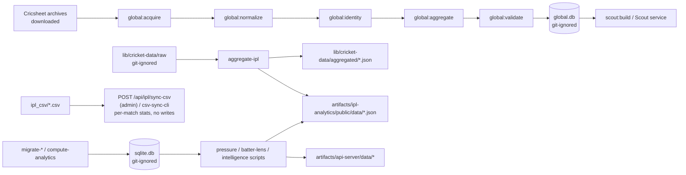

# Data pipeline

There are four separate pipelines. None of them runs on a schedule; each one is started by hand.

## 1. Global multi-league warehouse (`scripts/src/global`)

Run from the repo root with `pnpm --filter @workspace/scripts run <script>`.

| Script | Does |
|---|---|
| `global:sync` | Full update: check Cricsheet, download changed archives, then rebuild what changed |
| `global:build` | The same from archives already on disk (`--skip-download`, no network) |
| `global:acquire`, `global:normalize`, `global:identity`, `global:aggregate`, `global:validate` | Single steps, in that order |
| `global:onboard`, `global:bench` | Onboard a competition; benchmark |
| `scout:build`, `scout:demo` | Scouting tables and demos (`scripts/src/scout`) |
| `test:global`, `test:step3` | Tests, run against a read-only warehouse |

- Output: `lib/cricket-data/global/warehouse/global.db` (git-ignored, about 155 MB locally). Raw archives go to `lib/cricket-data/global/raw/` (git-ignored).
- Tracked: `lib/cricket-data/global/manifests/` and `lib/cricket-data/global/reports/`.
- Schema: `scripts/src/global/schema.sql`. Paths: `scripts/src/global/paths.ts`.
- `sync.ts` states that it never touches `sqlite.db` or the IPL site.
- Background: [docs/global-data-engine/](global-data-engine/README.md).

## 2. IPL JSON aggregates (`scripts/src/aggregate-ipl.ts`)

`pnpm --filter @workspace/scripts run aggregate-ipl` reads `lib/cricket-data/raw/` (git-ignored). It writes each output file twice: to `lib/cricket-data/aggregated/` and to `artifacts/ipl-analytics/public/data/`. Production serves the second copy.

`update-ipl-data` (the root `pnpm update-ipl-data`) and `update-ipl-data-v3` merge `artifacts/api-server/data/players.json` (hand-curated roles) into the data. The older `migrate-*`, `compute-analytics` and `db:migrate` scripts write `sqlite.db` through `@workspace/db`. Point them at a copy with `CRICFIELD_DB_PATH`.

## 3. Per-match Cricsheet CSVs (`ipl_csv/`)

`ipl_csv/` holds 1,244 tracked per-match Cricsheet CSV files. `artifacts/api-server/src/services/csv-dataset.ts` resolves a numeric match id to `ipl_csv/<matchId>.csv`, and `cricsheet-csv-sync.ts` parses that file and computes filtered stats for it. You can run this in two ways:

- `POST /api/ipl/sync-csv` (admin only, heavy rate limit)
- `pnpm --filter @workspace/api-server exec tsx src/scripts/csv-sync-cli.ts <matchId>`

Neither one writes `sqlite.db`. The warehouse itself was built by the `migrate-*` / `compute-analytics` scripts above. This audit did not trace the original build order of `sqlite.db`.

## 4. Model and feature builds (`artifacts/api-server/scripts`)

| Folder | Builds | Writes |
|---|---|---|
| `pressure/` | `build-pressure-reliability.ts`, `ingest-official.ts`, `rankings-report.ts` | `api-server/data/pressure/`, `public/data/pressure-reliability.json`, `docs/pressure-reliability/` |
| `batter-lens/` | `build-batter-lens.ts` | `public/data/batter-lens/` |
| `intelligence/` | `pnpm --filter @workspace/api-server run intelligence:train` runs features, then `train.py` (Python), then publish | `api-server/data/intelligence/cf-intel-*/snapshot.json` |
| `retention/` | `v2-report.ts` | `docs/retention-room/v2-report.json` |

Official challenge data (`lib/cricket-data/official/`, `artifacts/api-server/data/pressure-official/`) is git-ignored and must stay out of git.

## Undocumented generators (known gap)

Several files in `public/data/` were produced by one-off scripts in `scratch/` and `scripts/*.py` / `scripts/*.mjs`, for example `scratch/compile-player-bio.js` and `scratch/build-squads.mjs`, which is cited in `stats-aggregator.ts`. These scripts are not wired to any package script. Treat `scratch/` as a source of truth for how some data was made until each script is reviewed; see [REPOSITORY_AUDIT.md](REPOSITORY_AUDIT.md).

## Duplicate copies

25 JSON file names exist in both `artifacts/api-server/data/` and `artifacts/ipl-analytics/public/data/`. Measured on 2026-11-16, 17 pairs were byte-identical and 8 differed, including `player-season-stats.json`, `top-batters.json` and `player-team-season-stats.json`. The API reads its own copy and the static site reads the `public/data` copy. On a static host the site can therefore show different numbers from the API for those 8 files. Check which copy is correct before you edit either one.
