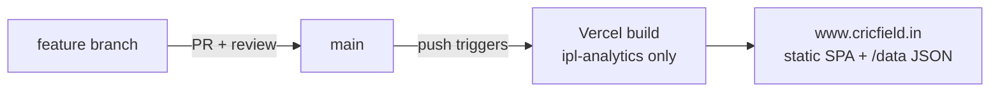

# Deployment

## Production today: static frontend on Vercel

Production at https://www.cricfield.in is configured by `vercel.json`:

| Setting | Value |
|---|---|
| Install | `pnpm install` |
| Build | `pnpm --filter @workspace/ipl-analytics run build` |
| Output | `artifacts/ipl-analytics/dist/public` |
| Rewrites | every path → `/index.html` (SPA) |
| Cache | `/data/*` 1 hour; `/assets/*` 1 year, immutable |

`.vercelignore` keeps `node_modules` and build output out of the upload. Vercel builds and deploys `main` automatically on every push. **Pushing to `main` is a production release.**



What this means:

- **No API runs in production.** `/api/*` is rewritten to `index.html`. Pages that read through `fetchJson` (`src/lib/aggregates.ts`) fall back to `/data/<name>.json`. Features that only call the API cannot work on this host, for example the AI Analyst, the simulators, Scout queries, notifications and admin routes. This audit did not check each page for its own static fallback.
- Production data is whatever is committed under `artifacts/ipl-analytics/public/data/`. To change it you change a file in git and redeploy.
- `VITE_*` variables are set in the Vercel project settings. They are public by construction.

## Optional: running the API

The API can serve the built SPA itself (`app.ts` serves `ipl-analytics/dist/public` when that folder exists):

```bash
pnpm --filter @workspace/ipl-analytics run build
```

```bash
pnpm --filter @workspace/api-server run build
```

```bash
CRICFIELD_DB_READONLY=1 NODE_ENV=production pnpm --filter @workspace/api-server run start
```

A host for the API needs `sqlite.db` (and `global.db` for Scout) next to the code, `CRICFIELD_DB_READONLY=1`, and `TRUST_PROXY` set to the real proxy hop count. Secrets go in the host's environment, never in git. `.replit` holds an older Replit autoscale configuration. This audit did not verify it as a current deployment path.

## Release checklist

1. Work on a branch and open a PR. Never push straight to `main`.
2. Run the checks in [TESTING.md](TESTING.md). The web build must succeed, because it is exactly what Vercel runs.
3. If `public/data` changed, compare row counts and checksums with the previous version.
4. After merge, open the Vercel deployment and check the home page, a player page and `/data/*` responses.

## Rollback

In Vercel, promote the previous production deployment. Or revert the merge commit on `main` with `git revert -m 1 <merge-sha>` and push. Never rewrite `main`'s history.
