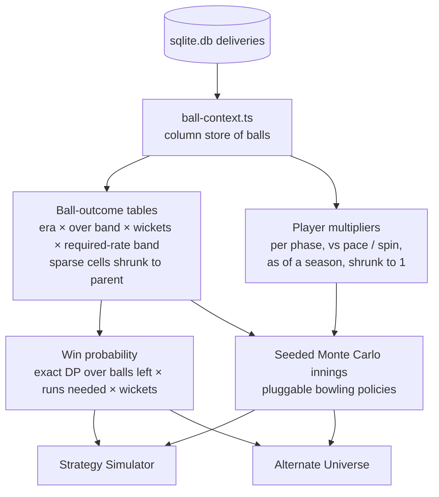

# Scenario intelligence

"Scenario intelligence" covers two kinds of feature in the API:

1. **Scenario statistics:** filtered warehouse aggregates for named match situations.
2. **Simulators:** the Decision Intelligence match engine that answers what-if questions.

None of this runs in production, which is a static site. The pages that call these endpoints need a running API.

## 1. Scenario statistics: `GET /api/scenario-intelligence`

Route: `artifacts/api-server/src/routes/ipl.ts`. Logic: `aggregateScenarioStats` in `services/stats-aggregator.ts`. Heavy rate limit.

- `scenario`: `chasing200plus`, `defending150minus`, `playoff`, `death-spin`, `powerplay`, `death`, `high-pressure`, `clutch`
- Filters: `season`, `team`, `opponent`, `venue`, `phase`, `bowlerType`, `deliveryType`, `pressure`, `innings`, `nationality`, `matchContext`, `minBalls` (default 10), `minRuns` (default 0)

## 2. The match engine (`services/decision/match-model.ts`)

- Outcomes per ball: dot, 1, 2, 3, 4, 6, wicket, wide, no-ball.
- Eras: up to 2012, 2013–17, 2018–22, 2023 onward. Phases: overs 0–5 powerplay, 6–14 middle, 15+ death. Shortened innings are mapped onto 20-over equivalents.
- Player profiles are recency-weighted "as of" a season, so historical what-ifs never see later seasons.

## 3. Simulators (`artifacts/api-server/src/routes/decision-intel.ts`)

| Endpoint | Service | What it answers |
|---|---|---|
| `POST /api/strategy/simulate` | `strategy-sim.ts` | A chase in progress, from the bowling side: given the target, score, balls, wickets, batters and the attack's remaining overs, it simulates the rest of the innings many times under three bowling plans and ranks the next-over options. The output also shows the league baseline and real historical chases from similar positions. |
| `POST /api/alt-universe/simulate` | `alt-universe.ts` | Takes a real innings and an over, then simulates the rest twice with the same random seeds: a baseline with the real bowlers, and an alternate with one bowler swapped or every remaining over bowled by one type. The difference is the change, not noise, and the baseline is also compared with what really happened. |

Other Decision Intelligence services in `services/decision/` (routes in `decision.ts` and `decision-intel.ts`; see [API_REFERENCE.md](API_REFERENCE.md)):

`playing-xi.ts` (XI optimiser, uses `javascript-lp-solver`), `opposition-map.ts`, `weakness-detector.ts`, `decision-replay.ts`, `squad-dna.ts`, `pressure-genome.ts`, `auction-war-room.ts`, `player-pool.ts`, `insight-feed.ts`, `nl-parser.ts` + `stats-engine.ts` (`POST /api/ask`).

Frontend pages: `/ai-analyst/strategy-sim`, `/ai-analyst/alt-universe`, `/ai-analyst/decision-replay`, `/ai-analyst/opposition-map`, `/ai-analyst/playing-xi` and others under `/ai-analyst/*` (`artifacts/ipl-analytics/src/App.tsx`).

## Limits

- The output is a simulation from historical outcome tables, not a forecast that has been validated against future matches. This audit found no calibration report for the strategy simulator. Treat its rankings as decision support.
- The engine reads only the IPL warehouse (`sqlite.db`).
