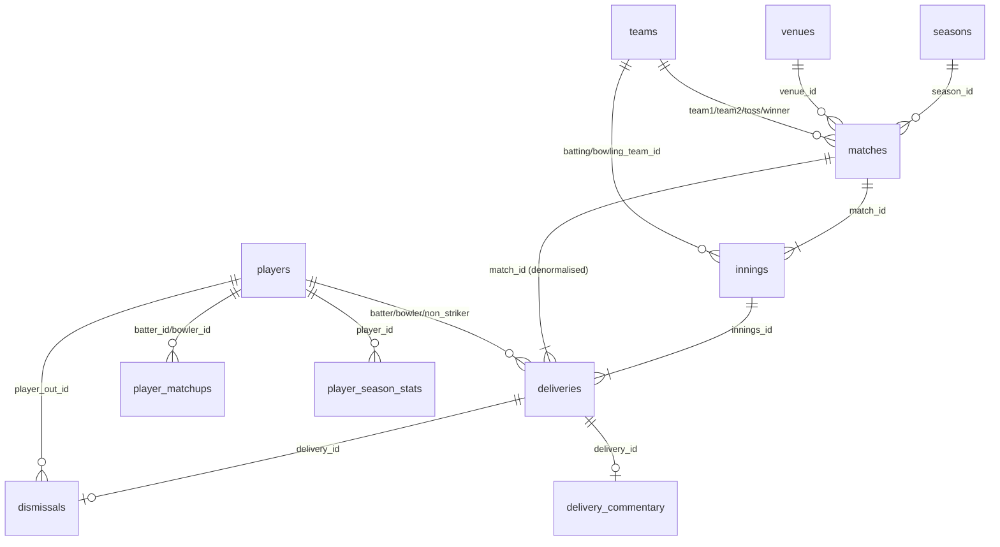

# 04 — Database Engineering

> **Read this chapter in three passes.** Beginner: §1–§2. Engineer: §3–§7. Interview: §8–§10.
> All counts were taken on 2026-10-12 by opening the databases **read-only** (`new DatabaseSync(path, { readOnly: true })`). Query timings were measured on a *copy* of `sqlite.db`, never the production file.

---

## 1. Beginner view: what a “warehouse” is here

CricField stores cricket in two **SQLite** files. SQLite is a full SQL database that lives inside one file and is read by a library *inside* the application process — there is no separate database server to run.

| Database | File | What it holds | Who reads it |
|---|---|---|---|
| **IPL warehouse** | `sqlite.db` (repo root, 119 MB + 27 MB WAL) | 1,243 IPL matches 2008–2026, 295,732 deliveries, plus precomputed player/team tables | The Express API (Advanced Stats, player pages, every AI Analyst module, Dugout, War Room) |
| **Global warehouse** | `lib/cricket-data/global/warehouse/global.db` (79 MB, gitignored) | 3,309 matches across IPL, SMAT, BBL, SA20, CPL, ILT20; 771,965 deliveries; identity tables; scouting tables | The global ETL CLI and the Scout Lab API (`/api/scout/*`) |

A **delivery** (one ball) is the atomic fact. Everything else — a batter’s strike rate, a team’s powerplay run rate, an auction valuation — is an aggregation of deliveries.

---

## 2. Why two databases instead of one

| Reason | Evidence |
|---|---|
| **Risk isolation.** The global engine was built later and was required never to change the live IPL site. It opens `sqlite.db` only read-only. | `docs/global-data-engine/README.md` “Boundaries”; `scripts/src/global/identity.ts` reads the IPL DB read-only |
| **Different schema philosophy.** `sqlite.db` uses surrogate integer IDs and denormalised flags (`is_wide`, `phase`), built by a script that *drops and recreates every table*. `global.db` keeps Cricsheet’s structure (0-based overs, per-type extras, `WITHOUT ROWID` composite keys) and is updated incrementally. | `scripts/src/update-ipl-data-v3.ts:19-45` vs `scripts/src/global/schema.sql` |
| **Rebuildability.** `global.db` is gitignored and rebuilt from hashed raw archives in ≈30 s. `sqlite.db` is tracked in git (119 MB binary) and has hand-applied fixes. | `.gitignore:61-63`; `docs/global-data-engine/README.md` |

**Trade-off you must be able to state in an interview:** two warehouses mean the same IPL ball exists twice, and the two copies can disagree (they did — see §7 economy residuals and the `is_bye` gap). The engine compensates with a *cross-check* (`scripts/src/global/validate.ts:202-306` compares player-season totals between the warehouses).

---

## 3. IPL warehouse (`sqlite.db`) — schema

25 tables. Row counts are live. **Bold** = core fact/dimension tables used by running code.

| Table | Rows | Purpose | Status |
|---|---:|---|---|
| **matches** | 1,243 | One row per match: season, date, venue, teams, toss, winner | ✅ `match_type` = “T20” for every row (it is the *format*, not the stage); playoff stage lives only in raw JSON |
| **innings** | 2,514 | Innings totals; `innings_number` 3–6 are **super overs** (16+16+1+1 rows) | ✅ |
| **deliveries** | 295,732 | One row per ball | ✅ core; see column notes below |
| **dismissals** | 14,705 | One row per wicket | ✅; `fielder_id` NULL on **all** rows |
| **players** | 1,141 | Player dimension, `cricsheet_id` UNIQUE | 🟡 `country`/`role` empty or “Unknown/Player” on 793 rows; 177 synthetic `json:N` ids (squad-only players) |
| **teams** | 19 | Franchises incl. renamed ones | ✅ |
| **venues** | 60 | Ground names (several variants of the same ground) | 🟡 |
| **seasons** | 20 | Season ids incl. Cricsheet labels `2007/08`, `2009/10`, `2020/21` and a synthetic `All` | 🟡 champions/runner-up NULL |
| **delivery_commentary** | 293,652 | Per-ball length, line, variation, shot, contact, zone, `speed_kph` (7,173 non-null) parsed from ESPN commentary | ✅ enrichment |
| fact_batting_innings | 18,842 | Per-innings batting line | 🟡 built at ingest |
| fact_bowling_spells | 14,734 | Per-innings bowling line | 🔴 credits “retired out” to bowlers (6 cases) |
| player_career_stats / season / team / team_season / phase | 804 / 3,337 / 1,631 / — / 2,193 | Precomputed aggregates | 🟡 built by `compute_analytics.ts` |
| player_matchups | 31,370 | Batter × bowler head-to-head | ✅ |
| current_squad, player_team_history | 804 each | “Latest team” derived from last appearance | 🟡 heuristic |
| team_intelligence, venue_intelligence | 19 / 60 | Team/venue summaries | 🟡 |
| auction_roi, partnerships, dim_scenario, dim_team_match_bridge | **0** | Empty — designed but never populated | ⚪ |
| insight_clicks | 1 | Click counter for `/api/ipl/insights/go/:slug` (the only table the API writes) | ✅ |

### 3.1 `deliveries` — the most important table

```sql
-- sqlite.db (abridged from the live schema)
CREATE TABLE deliveries (
  delivery_id    INTEGER PRIMARY KEY AUTOINCREMENT,   -- surrogate; chronological only WITHIN an innings
  match_id       TEXT    REFERENCES matches(match_id) ON DELETE CASCADE,
  innings_id     INTEGER REFERENCES innings(innings_id) ON DELETE CASCADE,
  over_num       INTEGER NOT NULL,                    -- 0-based (over 0 = first over)
  ball_num       INTEGER NOT NULL,                    -- 1..N position in the over (fixed 2026-10-11)
  batter_id, bowler_id, non_striker_id INTEGER REFERENCES players(player_id),
  batter_runs    INTEGER NOT NULL DEFAULT 0,
  extra_runs     INTEGER NOT NULL DEFAULT 0,
  total_runs     INTEGER NOT NULL DEFAULT 0,
  is_wide, is_noball            INTEGER NOT NULL DEFAULT 0,   -- populated
  is_bye, is_legbye, is_penalty INTEGER NOT NULL DEFAULT 0,   -- NEVER populated (0 on all rows)
  is_boundary, is_dot_ball, is_death_over, is_powerplay INTEGER,
  delivery_type, scoring_area TEXT,       -- commentary-derived today (see §7)
  pressure_state TEXT DEFAULT 'Standard', -- 'Standard' on all 295,732 rows (placeholder)
  current_rr, required_rr REAL,           -- placeholders (0)
  phase TEXT, wickets_left, wicket_seq, wickets_remaining, required_run_rate,
  delivery_seq INTEGER                    -- added 2026-10-11 with the sequencing fix
);
```

Verified facts (queries run on a copy):

| Check | Result |
|---|---|
| `SUM(is_wide)` / `SUM(is_noball)` | 9,876 / 1,226 |
| `SUM(is_bye)`, `SUM(is_legbye)`, `SUM(is_penalty)` | **0, 0, 0** — the ingest never sets them (`update-ipl-data-v3.ts:580` insert has no such columns) |
| `SUM(extra_runs)` | 20,209 |
| `pressure_state` distinct values | only `'Standard'` |
| `delivery_seq IS NULL` | 0 |

### 3.2 Indexes on `sqlite.db`

| Index | Columns | Used by |
|---|---|---|
| `idx_deliveries_batter` / `_bowler` | `batter_id` / `bowler_id` | player career, matchups |
| `idx_deliveries_match_id`, `_match_innings`, `_innings`, `_filter_lookup (match_id, over_num, ball_num)` | match scans | scorecards, season filters |
| `idx_matches_season`, `_venue_id`, `_team1_id`, `_team2_id`, `_teams` | | season/venue/team filters |
| `idx_dismissals_delivery`, `idx_dismissals_player_out` **and** `dismissals_player_out_idx` | | dismissals — note the **duplicate** index on `player_out_id` (wasted space, slower writes) |
| `idx_delcomm_*` | commentary `match_id`, `length`, `zone` | Advanced Stats delivery filters |

### 3.3 Relationships (ERD)



**Foreign keys are declared but enforcement depends on the connection.** `lib/db/src/index.ts` runs `PRAGMA foreign_keys = ON`; the decision layer opens read-only so enforcement is moot; the ingest turns them OFF while dropping tables (`update-ipl-data-v3.ts:20`).

---

## 4. Global warehouse (`global.db`) — schema

37 tables + 4 views, schema version 1, rules version `roles-v1` (`meta` table). Commented DDL: `scripts/src/global/schema.sql`, `scripts/src/scout/scout-schema.sql`.

### 4.1 Layers

```
Source registry   competitions(6) · source_files(6) · ingest_runs · meta · schema_drift(0)
Raw-faithful      matches(3,309) · innings(6,648) · deliveries(771,965) · wickets(39,972)
                  wicket_fielders(29,663) · powerplays · replacements · reviews · match_players(73,743)
Identity          players(18,623) · player_names(29,254) · player_source_ids(28,528)
                  identity_links(964) · identity_review_queue(177) · team_aliases(4)
                  teams(92) · venues(185) · venue_names(185)
Aggregates        agg_batting(32,192) · agg_bowling(25,757) · agg_fielding · agg_appearances
                  competition_baselines(260) · seasons(65)
Scouting          scout_batting_innings(51,567) · scout_bowling_innings(39,201) · scout_roles(11,759)
                  scout_phase_variance(260) · scout_coverage(65)
Enrichment        player_attributes(1,960) · attribute_link_issues(285)
Views             v_batting · v_bowling · v_competition_baselines · v_player_competitions
```

### 4.2 Design choices worth explaining

| Choice | Where | Why it matters |
|---|---|---|
| `deliveries` PK = `(match_id, innings_no, over_no, seq)` `WITHOUT ROWID` | `schema.sql` | `seq` is the **true bowling order inside the over**, so a 10-ball over cannot collide or wrap (the bug that hit `sqlite.db`). `WITHOUT ROWID` stores rows clustered by that key. |
| Per-type extras columns `wides, noballs, byes, legbyes, penalty` + `non_boundary` | `deliveries` | Runs conceded can be computed exactly; the IPL warehouse cannot. |
| `extra TEXT` columns + `schema_drift` table | every raw table | Unknown JSON keys are preserved, never dropped silently. |
| `in_latest_source` flag | `matches` | A match missing from the newest archive is flagged, not deleted (lineage). |
| Aggregates keyed `(player_key, competition_id, season_label, phase)` | `agg_batting/agg_bowling` | One row per player-competition-season-phase; any window is a SUM. Phase rows sum to the `all` row (asserted in tests). |
| `scout_phase_variance` holds `n, Σx, Σx²` | scouting | Lets the API compute per-ball variance for any season window without re-scanning deliveries. |

### 4.3 Global indexes

| Index | Note |
|---|---|
| `ix_matches_competition_season (competition_id, season_label)`, `ix_matches_start_date` | |
| `ix_deliveries_batter`, `ix_deliveries_bowler` | |
| `ix_sbi_player / ix_sbo_player (player_key, competition_id, season_label)` | scouting innings |
| `ix_player_names_name`, `ix_player_source_ids_lookup (source, source_id)` | identity lookups |
| **Gap:** `agg_batting/agg_bowling` have no index leading with `competition_id`. The rankings query `WHERE competition_id = ? AND phase = ? AND season_label IN (…)` relies on the PK’s *skip-scan* (`SEARCH … USING PRIMARY KEY (ANY(player_key) AND competition_id=? …)` — see Q7 plan). Fast today (≤ 32 k rows) but it would not scale to 100× the data. |

---

## 5. Data dictionary (core columns)

### 5.1 Cricket terms → columns

| Concept | IPL warehouse expression | Global warehouse expression |
|---|---|---|
| Ball faced (batter) | `is_wide = 0` | `wides = 0` |
| Legal ball (bowler) | `is_wide = 0 AND is_noball = 0` | `wides = 0 AND noballs = 0` |
| Runs off the bat | `batter_runs` | `runs_batter` |
| Runs conceded by bowler | `RUNS_CONCEDED_SQL` = `batter_runs + (is_wide ? extra_runs : 0) + (is_noball ? 1 : 0)` (`services/decision/db.ts:88`) | `runs_batter + wides + noballs` |
| Boundary | `batter_runs IN (4,6)` (no `non_boundary` flag) | `runs_batter IN (4,6) AND non_boundary = 0` |
| Phase | `over_num` 0–5 PP, 6–14 middle, 15–19 death | same, plus 5-ball sets for The Hundred |
| Super over | `innings.innings_number > 2` | `innings.super_over = 1` |
| Bowler wicket | `dismissals.kind NOT IN ('run out','retired hurt','retired out','obstructing the field', …)` | metric definition in `scripts/src/global/metrics.ts` |

### 5.2 Columns you must **not** trust

| Column | Why |
|---|---|
| `deliveries.is_bye / is_legbye / is_penalty` | Always 0 |
| `deliveries.pressure_state / current_rr / required_rr` | Placeholders; real match state is rebuilt in `services/decision/ball-context.ts` |
| `matches.match_type` | Always “T20” |
| `seasons.champion_team_id` | NULL |
| `dismissals.fielder_id` | NULL |
| `players.country / role` | Mostly empty; app merges `squads-by-season.json`, `player-bio.json` (`services/decision/player-profiles.ts`) |
| `fact_bowling_spells.wickets` | Credits “retired out”; use `dismissals` |
| `delivery_id` order across matches | Ingest order, not date order — sort by `matches.date` |

---

## 6. Representative SQL (all executed; timings on a copy)

> SQL is shown in a readable form. Production code builds equivalent queries with **parameters** (`?`) — see §9 on SQL injection.

### Q1 — Player career batting (IPL, super overs excluded)

```sql
SELECT p.name,
       COUNT(DISTINCT d.match_id)                         AS matches,
       SUM(d.batter_runs)                                 AS runs,
       SUM(CASE WHEN d.is_wide = 0 THEN 1 ELSE 0 END)     AS balls,      -- wides are not balls faced
       ROUND(100.0 * SUM(d.batter_runs)
             / SUM(CASE WHEN d.is_wide = 0 THEN 1 ELSE 0 END), 2) AS sr,
       SUM(d.batter_runs = 4) AS fours, SUM(d.batter_runs = 6) AS sixes
FROM deliveries d
JOIN innings i ON i.innings_id = d.innings_id
JOIN players p ON p.player_id  = d.batter_id
WHERE p.name = 'V Kohli' AND i.innings_number <= 2          -- exclude super overs
GROUP BY p.player_id;
```

- **Result:** V Kohli — 275 matches, 9,336 runs, 6,926 balls, SR 134.8, 845 fours, 317 sixes. **81 ms.**
- **Plan:** `SCAN p | SEARCH d USING INDEX idx_deliveries_batter | SEARCH i USING INTEGER PRIMARY KEY | TEMP B-TREE FOR count(DISTINCT)` — the players scan is cheap (1,141 rows) but an index on `players(name)` would remove it.
- **Edge cases:** `COUNT(DISTINCT match_id)` counts matches *batted in*, not matches played (a player who did not bat is missed — use `agg_appearances`/squads for appearances). Dismissals must come from `dismissals` (Q1b: 231 outs, 10 ms), excluding `retired hurt`.

### Q2 — Season strike-rate leaders (2025, min 200 balls)

```sql
SELECT p.name, SUM(d.batter_runs) runs, SUM(d.is_wide = 0) balls,
       ROUND(100.0 * SUM(d.batter_runs) / SUM(d.is_wide = 0), 1) sr
FROM deliveries d
JOIN matches m ON m.match_id = d.match_id
JOIN innings i ON i.innings_id = d.innings_id
JOIN players p ON p.player_id = d.batter_id
WHERE m.season_id = '2025' AND i.innings_number <= 2
GROUP BY d.batter_id HAVING balls >= 200
ORDER BY sr DESC LIMIT 5;
```

Result: N Pooran 196.3 (524/267), Abhishek Sharma 193.4, Priyansh Arya 182.3, PD Salt 176.0, SS Iyer 175.1. **71 ms**; plan starts from `idx_matches_season` then `idx_deliveries_match_id`. **Season gotcha:** 2008, 2010, 2020 are stored as `2007/08`, `2009/10`, `2020/21`; `normalizeSeason()` in `services/decision/db.ts:60-70` maps them.

### Q3 — Bowling phase analysis: death-overs economy since 2022 (min 100 legal balls)

```sql
SELECT p.name,
       SUM(d.batter_runs + CASE WHEN d.is_wide=1 THEN d.extra_runs ELSE 0 END
                         + CASE WHEN d.is_noball=1 THEN 1 ELSE 0 END)          AS runs,
       SUM(d.is_wide = 0 AND d.is_noball = 0)                                  AS legal,
       ROUND(6.0 * SUM(/* same expression */ …) / SUM(d.is_wide=0 AND d.is_noball=0), 2) AS econ
FROM deliveries d JOIN matches m ON m.match_id=d.match_id
JOIN innings i ON i.innings_id=d.innings_id JOIN players p ON p.player_id=d.bowler_id
WHERE d.over_num >= 15 AND i.innings_number <= 2
  AND CAST(substr(m.season_id,1,4) AS INT) >= 2022
GROUP BY d.bowler_id HAVING legal >= 100 ORDER BY econ LIMIT 5;
```

- **Result:** SP Narine 6.06 (218 runs / 216 legal), JJ Bumrah 7.28, PWH de Silva 8.11, Noor Ahmad 8.26, L Ngidi 8.53. This matches the Ask page live output and an independent recount in `global.db` (218 runs, 216 balls).
- **871 ms. Plan:** `SCAN d USING INDEX idx_deliveries_bowler` — the whole table is walked in bowler order because no index covers `over_num` and the season filter is on `matches`. **Optimisation exercise:** a composite index `(over_num, bowler_id)` or reading from a pre-aggregated phase table (as `global.db` does) — see Challenge 11.
- **Why the CASE expression:** byes/leg-byes are not the bowler’s fault, but `is_bye` is never set, so the code charges only what it can *prove*: wides (all their runs) + 1 per no-ball + bat runs. This mis-states 17 deliveries (multi-run no-balls, a 5-penalty wide; net −30 runs) — documented in `docs/global-data-engine/step3/economy-residuals.md`.

### Q4 — Venue analysis: average first-innings score (min 20 matches)

```sql
SELECT v.name, COUNT(*) n, ROUND(AVG(i.runs),1) avg1
FROM innings i JOIN matches m ON m.match_id=i.match_id JOIN venues v ON v.venue_id=m.venue_id
WHERE i.innings_number = 1 GROUP BY v.venue_id HAVING n >= 20 ORDER BY avg1 DESC LIMIT 5;
```

Result: Uppal (Hyderabad) 194.7, Jaipur 194.5, Arun Jaitley 193.6, Chinnaswamy 190.4, Eden Gardens 190.3. **1 ms.** ⚠️ Venue names are not normalised in SQL (“Wankhede Stadium” and “Wankhede Stadium, Mumbai” are separate rows); the app rolls variants up in TypeScript (`resolveVenue` alias map, `stats-engine.ts`). Rain-shortened innings are averaged with full ones — a known bias.

### Q5 — Team comparison: head-to-head CSK v MI

```sql
SELECT w.short_name winner, COUNT(*) n
FROM matches m
JOIN teams a ON a.team_id IN (m.team1_id, m.team2_id) AND a.short_name='CSK'
JOIN teams b ON b.team_id IN (m.team1_id, m.team2_id) AND b.short_name='MI'
LEFT JOIN teams w ON w.team_id = m.winner_id
GROUP BY m.winner_id;
```

Result: MI 21, CSK 20. **1 ms.** Franchise renames (Delhi Daredevils→Capitals, Kings XI→Punjab Kings, RCB Bangalore→Bengaluru) are separate `teams` rows; queries must group through the alias map (`stats-aggregator.ts:214 getTeamAliases`).

### Q6 — Player comparison: batter v bowler (Kohli v Bumrah)

Result: 164 runs off 110 balls, 5 dismissals. **4 ms** via `idx_deliveries_bowler`. Production uses the precomputed `player_matchups` table or `stats-engine.ts`.

### Q7 — Global T20 scouting: death-overs strike rate, IPL + BBL, latest seasons

```sql
SELECT p.unique_name, c.code, SUM(a.runs) runs, SUM(a.balls_faced) balls,
       ROUND(100.0*SUM(a.runs)/SUM(a.balls_faced),1) sr
FROM agg_batting a JOIN competitions c USING (competition_id) JOIN players p USING (player_key)
WHERE c.code IN ('ipl','bbl') AND a.phase='death' AND a.season_label IN ('2026','2025/26')
GROUP BY a.player_key, c.code HAVING balls >= 60 ORDER BY sr DESC LIMIT 5;
```

Result: Tilak Varma 256.7 (154/60), D Ferreira 221.7, Nithish Kumar Reddy 215.9, TH David 214.1, SS Iyer 212.7 — **6 ms** because it reads pre-aggregated rows. **This is raw strike rate; Scout Lab ranks on league-adjusted, shrunk indices (Chapter 6), which is why its order differs.**

### Q8 — One player across leagues (AD Russell, by Cricsheet id `bbd41817`)

| League | Runs | Balls | SR | Outs |
|---|---:|---:|---:|---:|
| BBL | 454 | 291 | 156.0 | 19 |
| CPL | 2,117 | 1,257 | 168.4 | 79 |
| ILT20 | 675 | 405 | 166.7 | 23 |
| IPL | 2,651 | 1,522 | 174.2 | 94 |
| SA20 | 30 | 23 | 130.4 | 3 |

**1 ms.** The join is on the registry id, so no name matching is involved.

### Q9 — Performance trend: league run rate by phase (IPL 2024–2026)

`SELECT season_label, phase, ROUND(6.0*runs_total/legal_balls,2) FROM competition_baselines WHERE competition_id=1 …` → 2024 all 9.56, death 11.21, PP 9.47; 2025 all 9.63 … **1 ms**, PK search.

---

## 7. Data quality: fixed vs unresolved

| Issue | Status | Evidence |
|---|---|---|
| **Ball sequencing wrap** — `ball_num` restarted after the 9th delivery of an over (“19.10” parsed as float 19.1 → ball 1) | ✅ **Fixed 2026-10-11** in `sqlite.db` (`delivery_seq` added). Backup `sqlite.db.pre-delivery-fix.bak` shows `1,2,…,9,1,1`; current DB `1…11` for match 1473469 over 19. | `update-ipl-data-v3.ts:659-661` root cause; `scripts/src/step3/tests/delivery-sequence.test.ts` (3/3 pass on a copy). ⚠️ The script that applied the fix to production is **not in the repo** (lineage gap) and the ingest script still contains the float-parsing bug. |
| **Byes/leg-byes charged to bowlers** (7,142 runs across history) | ✅ Fixed in code via `RUNS_CONCEDED_SQL` | `services/decision/db.ts:77-89` |
| Residual: 17 deliveries / 13 bowlers / net −30 runs | 🟡 Unresolved; needs per-type extras columns (`scripts/src/step3_5/migrate-delivery-extras.ts` is written and refuses to touch production without `--allow-production`; **not applied**) | `economy-residuals.md` |
| Random `delivery_type`/`scoring_area` at ingest | 🟡 Current values are commentary-derived (`scratch/backfill-delivery-columns.mjs`); 95,511 / 100,451 NULLs. Re-running the ingest would re-introduce random values. | `update-ipl-data-v3.ts:678-681` |
| `pressure_state` placeholder | 🟡 Worked around (`ball-context.ts`) | |
| Duplicate player names | ✅ Handled by registry id in `global.db` (11 collision groups, e.g. two “Yuvraj Singh”) and by exact-only rules on player pages (Step 3) | `docs/global-data-engine/identity.md`; live check: `resolvePlayer("Yuvraj Singh")` returns 3 candidates and **no** player |
| 177 squad-only players with synthetic ids | 🟡 In `identity_review_queue`; 59 have exact-name candidates awaiting human review | `identity.md` |
| Empty designed tables (`partnerships`, `auction_roi`, …) | ⚪ | row counts |

---

## 8. Transactions, concurrency and integrity

- **Ingest** (`update-ipl-data-v3.ts`): one `BEGIN … COMMIT` per match file with `ROLLBACK` on error (`:735-741`), so a bad file never half-loads. But the script first **drops every table**, so a failure mid-run leaves a partial warehouse.
- **Global ETL**: incremental — only new or changed zip entries (by CRC) are re-normalised; whole steps run inside transactions; exit code 2 if validation fails.
- **Runtime**: `node:sqlite`’s `DatabaseSync` is **synchronous**. Every query blocks Node’s single event loop. Measured: one filtered `/api/stats/query` ≈ 2.3 s warm; ten concurrent ≈ **24 s** wall time (they queue). This is the system’s main scalability limit (Chapter 11).
- **WAL mode** (`PRAGMA journal_mode = WAL`) lets readers proceed while a writer appends; the 27 MB `-wal` file next to `sqlite.db` is un-checkpointed write-ahead log. Copying `sqlite.db` without its `-wal` gives a stale database — a classic backup mistake.

---

## 9. SQL injection posture

| Code path | Parameterised? |
|---|---|
| Decision layer (`services/decision/*`) | ✅ `db.prepare(sql).all(...params)` |
| Scout service | ✅ placeholders built with `inList()` (`"?"` per value). One string-interpolated fragment: `` `AND ${PHASE_SQL} = '${phase}'` `` (`scout-service.ts:390`) — safe only because `phase` is Zod-validated to an enum in `routes/scout.ts` |
| Legacy stats (`stats-aggregator.ts`) | ✅ Drizzle `sql` template tag binds `${…}` as parameters (e.g. `LIKE LOWER(${…})` at `:1772`) |
| Ingest scripts | 🟡 `db.exec(\`UPDATE innings SET runs = ${totalRuns} …\`)` (`update-ipl-data-v3.ts:715`) — values are computed numbers, not user input, so not exploitable, but it is a bad pattern to copy |

---

## 10. Interview-level questions this chapter prepares you for

1. Why is `COUNT(*)` of deliveries not “balls faced”? (Wides.) Why not “balls bowled”? (Wides and no-balls.)
2. Why does Q3 take 871 ms when Q7 takes 6 ms? (Raw fact scan vs pre-aggregated rows; index coverage.)
3. What breaks if you copy `sqlite.db` without the WAL file?
4. Why store per-type extras instead of one `extra_runs` column?
5. Why is `delivery_id` not safe for ordering across matches?
6. When would you move from SQLite to PostgreSQL/DuckDB? (Concurrent writers, multi-instance deploys, analytical scans over 10⁸ rows, need for async drivers.)
