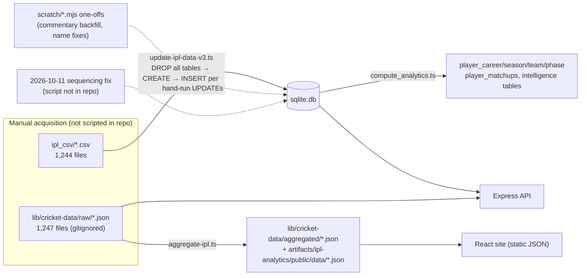
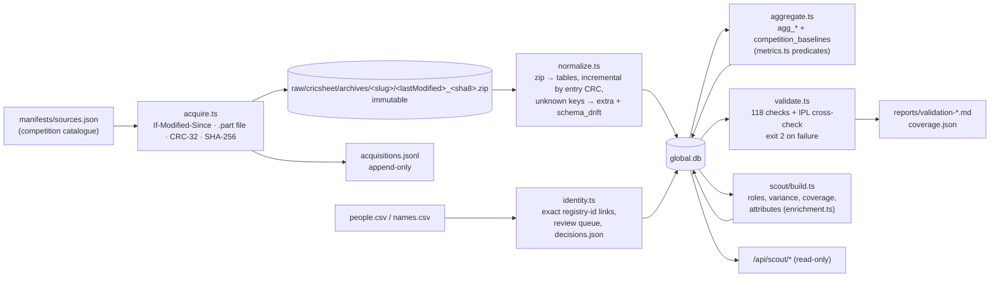

# 05 — Data Engineering and Cricket Data Modelling

> **Scope.** Where every number on the site comes from, how it is transformed, how it is checked, and which known problems remain. Two pipelines exist and they have very different maturity:
>
> | Pipeline | Maturity | One-line verdict |
> |---|---|---|
> | **A. IPL warehouse pipeline** (CSV → `sqlite.db` → static JSON) | 🟡 Grew organically; many one-off scripts; full drop-and-rebuild; hand-applied fixes | Works, but is **not reproducible end-to-end from the repo** |
> | **B. Global data engine** (Cricsheet archives → `global.db`) | ✅ Designed pipeline with hashing, incremental loads, 118 validation checks, tests | The strongest engineering in the repository |

---

## 1. Where match data originates

| Source | What | Licence / terms | Used by |
|---|---|---|---|
| **Cricsheet** (cricsheet.org) | Ball-by-ball JSON and CSV for every match; `people.csv`/`names.csv` registers | **ODC-BY 1.0** — free use **with attribution** | Both warehouses |
| ESPNcricinfo ball commentary | Length, line, variation, shot, zone, speed text per ball | **Not licensed for reuse** (scraped) | `delivery_commentary`, `ball-commentary.json` |
| Cricbuzz | Live scores, scorecards | **Not licensed** (scraped with a browser User-Agent) | `/api/live/*` |
| Google News RSS, ESPNcricinfo RSS | Headlines | RSS terms; link-out only | `/api/ipl/news` |
| `2026 ipl auction player list*.csv` | Official auction list: capped status, reserve price, specialism | Public document; provenance should be cited | War Room, scouting enrichment |
| `player-auctions.json`, `squads-by-season.json`, `player-bio.json`, `captains.json` | Auction prices since 2014, squads, bios | The `/data-sources` page states season and auction facts were compiled from Wikipedia (**CC BY-SA 4.0**, share-alike); per-file provenance is not recorded in the repo | War Room, Dugout, player metadata |
| Official IPL / franchise sites | Player photos (≈100 scraping scripts in `scripts/*.mjs`) | **Copyrighted images** | Player avatars |

> **Interview-grade honesty:** only the Cricsheet-derived parts have a clean licence. Commentary text, live scores and photos come from scraping. That is acceptable for a personal learning project but is the first thing a franchise or employer would ask about (Chapter 25 §licensing).

---

## 2. How raw files are structured (Cricsheet JSON 1.2.0/1.3.0)

```jsonc
{
  "meta": { "data_version": "1.2.0", "revision": 1 },
  "info": {
    "dates": ["2025-05-26"], "season": "2025", "teams": ["Punjab Kings", "Mumbai Indians"],
    "event": { "name": "Indian Premier League", "stage": "Qualifier 1" },   // only place the stage exists
    "registry": { "people": { "RG Sharma": "740742ef", … } },              // name → stable 8-hex id
    "toss": {…}, "outcome": { "winner": "…", "by": { "wickets": 7 } },
    "overs": 20, "balls_per_over": 6, "players": { "<team>": ["…", …] }
  },
  "innings": [
    { "team": "Mumbai Indians",
      "target": { "runs": 204, "overs": 20 },                               // chases (incl. DLS)
      "overs": [
        { "over": 0, "deliveries": [
            { "batter": "RG Sharma", "bowler": "…", "non_striker": "…",
              "runs": { "batter": 0, "extras": 1, "total": 1 },
              "extras": { "wides": 1 } },                                    // wides / noballs / byes / legbyes / penalty
            { …, "wickets": [{ "player_out": "…", "kind": "caught", "fielders": [{ "name": "…" }] }] }
        ]}
      ]}
  ]
}
```

The CSV variant (`ipl_csv/*.csv`, 1,244 files) flattens each ball to one row with columns `match_id, season, start_date, venue, innings, ball ("19.4"), batting_team, bowling_team, striker, non_striker, bowler, runs_off_bat, extras, wides, noballs, byes, legbyes, penalty, wicket_type, player_dismissed, …`.

---

## 3. Pipeline A — IPL warehouse

### 3.1 Flow



### 3.2 Steps with code locations

| # | Step | Code | Notes |
|---|---|---|---|
| 1 | Acquire CSV/JSON | **none in repo** | Files were downloaded by hand. `.gitignore:52` excludes `lib/cricket-data/raw/`, so a fresh clone **has no raw JSON** and many API features (`getMatchData`, stage filters, ball context) silently degrade. |
| 2 | Rebuild schema | `scripts/src/update-ipl-data-v3.ts:19-345` | Drops 23 tables then recreates them. |
| 3 | Identity | `:378-575` | Builds a canonical player map from each file’s registry + `artifacts/api-server/data/players.json`; one row per Cricsheet id; fallback key `name:<string>` when a file has no registry (0 such rows today). |
| 4 | Load matches, innings, deliveries, dismissals | `:578-741` | One transaction per file; `ROLLBACK` on any error. |
| 5 | Per-innings facts | `:702-733` | `fact_batting_innings`, `fact_bowling_spells` computed in memory. |
| 6 | Squads | `:750-785` | `current_squad` = team of last appearance (heuristic). |
| 7 | Analytics tables | `scripts/src/compute_analytics.ts` | Career/season/team/phase/matchups. |
| 8 | Static JSON for the site | `scripts/src/aggregate-ipl.ts` → writes both `lib/cricket-data/aggregated/` and `public/data/` (`:907-908`) | Overview, top batters/bowlers, seasons, matches, squads… |
| 9 | Enrichment | `scratch/build-delivery-commentary.mjs`, `scratch/backfill-delivery-columns.mjs`, `scratch/fix-db-player-names.mjs` | **One-off scripts in `scratch/`**, run by hand. |

### 3.3 How each cricket concept is modelled (IPL warehouse)

| Concept | Implementation | Problem / fix |
|---|---|---|
| **Over/ball** | `overBall = parseFloat("19.4")`; `overNum = floor`; `ballNum = round((overBall − overNum) × 10)` (`:659-661`) | 🔴 “19.10” → 19.1 → ball 1. Every over with >9 deliveries wrapped. **Fixed in data on 2026-10-11** (`delivery_seq`), **still present in the script**. Correct approach: split the string on “.” and parse each part as an integer, or use the JSON’s array position (as `global.db` does with `seq`). |
| **Legal vs illegal delivery** | `is_wide`, `is_noball` from CSV columns 9/10 | ✅ |
| **Ball faced** | `if (!isWide) balls += 1` (`:705`) | ✅ no-balls are faced |
| **Bowler runs conceded (ingest)** | `totalBallRuns − byes − legbyes` (`:712`) | ✅ correct in `fact_bowling_spells`; but `is_bye/is_legbye` are not stored, so SQL over `deliveries` cannot repeat this → `RUNS_CONCEDED_SQL` workaround |
| **Bowler wicket** | excludes `run out`, `retired hurt`, `obstructing the field` (`:714`) | 🔴 forgets `retired out` (6 cases) |
| **Dot ball** | `runsOffBat === 0 && extras === 0` | ⚠️ treats a leg-bye as *not* a dot for the batter; Cricsheet convention (and `global.db`) counts byes/leg-byes as batting dots |
| **Phase** | `overNum < 6` PP, `≥ 15` death | ✅ consistent with global engine |
| **Super overs** | innings 3–6 stored; excluded at query time (`innings_number <= 2`, JSON path `inningIndex >= 2`) | ✅ |
| **Franchise renames** | separate `teams` rows; alias map `TEAM_ALIASES` in `migrate_deliveries.ts`, `getTeamAliases()` in `stats-aggregator.ts:214` | ✅ Deccan Chargers ≠ Sunrisers is a deliberate rule (`stats-aggregator.ts:140-150` comment) |
| **Seasons** | Cricsheet labels kept (`2007/08`, `2009/10`, `2020/21`) | normalised in code (`normalizeSeason`) |
| **Delivery type / scoring area** | `Math.random()` at ingest (`:678-681`) | 🔴 latent; data later overwritten from commentary (§6) |

---

## 4. Pipeline B — Global data engine

### 4.1 Flow



One command runs all of it: `pnpm --filter @workspace/scripts run global:sync` (or `global:build` offline). Full rebuild ≈ 27 s, identical to the incremental result (`docs/global-data-engine/README.md`).

### 4.2 Engineering properties that are genuinely good

| Property | How |
|---|---|
| **Idempotent, incremental** | A match is re-ingested only if new or its zip-entry CRC changed (`normalize.ts` header) |
| **Immutable raw layer** | Archives stored by `<lastModified>_<sha8>`; never deleted |
| **Lineage** | `acquisitions.jsonl` (url, time, Last-Modified, bytes, SHA-256), `source_files`, `ingest_runs`, `meta` timestamps, `in_latest_source` flags |
| **Schema drift detection** | Unknown JSON keys stored verbatim + counted (`schema_drift` = 0 rows today) |
| **Single source of metric truth** | Every predicate in `scripts/src/global/metrics.ts`, pinned by `tests/metrics.test.ts` |
| **Validation as a gate** | `validate.ts` → 118 PASS, 2 WARN, 0 FAIL on 2026-10-10 (`reports/validation-2026-10-10.md`) |
| **No guessing** | Attributes Cricsheet lacks (bowling style, hand, capped) are linked only from named sources, with `confidence`; unlinkable rows go to `attribute_link_issues` (285) |

### 4.3 The validation checks (per competition)

From `scripts/src/global/validate.ts:78-189`:

| Check | IPL result (2026-10-10) |
|---|---|
| Match counts agree (catalogue, archive, README, database) | 1,243 everywhere |
| Every match male / club / 5–6-ball overs | 0 non-conforming |
| `runs.total = batter + extras` **and** `extras = wides + noballs + byes + legbyes + penalty` | 0 failures / 295,732 |
| Legal balls per over ≤ balls_per_over (except Cricsheet `miscounted_overs`) | 4 long overs, all explained |
| Overs per innings ≤ scheduled | 0 |
| Wickets per innings ≤ 10 (≤ 2 in super over), retired hurt excluded | 0 |
| Win by runs = 1st total − 2nd total | 545 checked, 0 differ |
| Win by wickets = 10 − wickets lost | 650 checked, 0 differ |
| Winning chase reaches target | 650 checked, 0 short |
| Ties have equal totals | 16 checked, 0 differ |
| Target = 1st total + 1 (non-DLS) | 1,203 checked, 0 differ |
| Every delivery references known players; every squad player in register | 0 orphans |
| Season gaps / thin seasons / schema drift | continuous / none / 0 |
| **Cross-warehouse:** player-season totals global vs `sqlite.db` | reported in the same file (`:202-306`) |

The two WARNs are source facts (e.g., SMAT has no 2016/17 season in Cricsheet).

---

## 5. Player and team identity

**Rule 1 — the canonical key is the Cricsheet registry id** (8 hex chars, e.g. `bbd41817` = AD Russell). Every match file maps the written name to this id in `info.registry.people`.

**Rule 2 — names never merge records.** Verified live: `resolvePlayer("Yuvraj Singh")` returns three candidates (`1c914163 Yuvraj Singh`, `30829ea2 Yuvraj Singh (2)`, `f0a99c08 YY Singh`) and **no** player, forcing disambiguation.

**Rule 3 — anything without an exact id goes to a review queue** with evidence; a human decision is stored in `manifests/identity-decisions.json` (tracked, survives rebuilds).

| Bridge statistic (IPL warehouse → global) | Value |
|---|---|
| Players in `sqlite.db` | 1,141 |
| Linked exactly by registry id | 964 |
| Synthetic `json:N` ids (squad-only, never faced or bowled) | 177 → review queue; 59 have exact-name candidates |

**Player-page identity (Step 3 / 3.5).** The website’s player pages originally matched names by initial + surname, so “Prince Choudhary” showed Mukul Choudhary’s matches. Step 3.5 replaced this with exact registry-identity resolution and an audit (`scripts/src/step3/identity-audit.ts`). Its latest saved report (`docs/global-data-engine/step3_5/identity-audit.md`) shows 778 correct pages, 10 empty (no verified identity), **0 wrong**. **Today’s run, however, reports 20 pages as “MISSING (empty page)”** (e.g., `gurjapneet-singh`, `salil-arora`) — the bios have no verified key, so the page shows an empty state although the player has matches. That is a regression against the Step 3 test (Chapter 10).

**Team identity.** `manifests/team-aliases.json` lists four explicit, sourced renames (Daredevils→Capitals, Kings XI→Punjab Kings, Rising Pune Supergiants→Supergiant, RCB Bangalore→Bengaluru). Nothing is inferred from name similarity.

---

## 6. Extras, wickets and unusual deliveries

| Situation | Correct cricket rule | Global warehouse | IPL warehouse |
|---|---|---|---|
| Wide | Not a ball faced; not a legal ball; all wide runs charged to bowler | ✅ | ✅ |
| No-ball | Ball faced; not legal; 1 run (the no-ball penalty) charged to bowler + bat runs | ✅ | ✅ via `RUNS_CONCEDED_SQL` |
| No-ball where batters also *run* byes | byes are not the bowler’s | ✅ (`noballs` + `byes` separate) | 🟡 cannot split → 16 of the 17 residual deliveries |
| Bye / leg-bye | Ball faced; legal; **not** charged to bowler; batting dot | ✅ | 🟡 flags not stored |
| Penalty runs | Not charged to bowler | ✅ | 🟡 1 residual delivery (wide + 5 penalty) |
| Boundary that was actually run (`non_boundary`) | Not a four | ✅ | 🔴 counted as a four |
| Retired hurt | Not a dismissal | ✅ | ✅ |
| Retired out | Batting dismissal, **not** a bowler wicket | ✅ | 🔴 credited to bowler in `fact_bowling_spells` |
| Run out of the non-striker | Dismissal of the non-striker | ✅ | ✅ (`player_out`) |
| Super over | Excluded from career stats | ✅ `super_over` flag | ✅ innings 3–6 excluded at query time |
| DLS-shortened chase | Target from the file | ✅ `target_runs/overs` | rebuilt from raw JSON in `ball-context.ts` (34 DLS targets) |
| Over with 10+ deliveries | Keep true order | ✅ `seq` | ✅ after 2026-10-11 fix |

---

## 7. How scorecards and aggregates are computed

- **IPL scorecards** (`/api/ipl/match/:id/scorecard`) are built by `services/match-card.ts` from the raw Cricsheet JSON, not from SQL — so the scorecard is independent of warehouse bugs but requires `lib/cricket-data/raw/`.
- **Advanced Stats** has two engines (`services/stats-aggregator.ts:703-730`): a **SQL path** (Drizzle over `sqlite.db`) and a **JSON replay path** that walks every ball of every raw file in memory (all 1,247 files are pre-loaded at boot — `preLoadAllMatches()`). The JSON path is used when the filter needs per-ball context the DB lacks (batting hand, pressure). Two engines for one feature means two sets of rules to keep consistent — a maintainability risk.
- **Decision modules** use a third representation: `ball-context.ts` builds **typed-array column stores** (~25 MB for 295k balls) once at startup so simulations can scan every ball in milliseconds.
- **Global aggregates** are additive counts per (player, competition, season, phase); every rate is computed *after* summing, never by averaging rates — the correct way to combine samples.

---

## 8. How data is refreshed

| Data | Refresh | Automated? |
|---|---|---|
| `global.db` | `global:sync` → incremental | ✅ one command; **not scheduled** (manual) |
| `sqlite.db` | `update-ipl-data-v3` (full rebuild) + `compute-analytics` + hand-run `scratch/` fixes + the undocumented sequencing fix | 🔴 not reproducible: re-running the documented steps would **lose** the commentary backfill and **re-introduce** the ball-number wrap and random delivery types |
| Static JSON (`public/data`) | `aggregate-ipl` and several generators (`scripts/generate-player-recent-matches.mjs`, …) | 🟡 manual |
| Live scores / news | On request with in-memory caching | ✅ runtime |
| Photos | ~100 one-off scripts + registry validation (`scripts/validate-photo-registry.mjs`) | 🟡 manual |
| `drizzle-kit push` | `scripts/post-merge.sh` runs `pnpm --filter db push` against `../../sqlite.db` after every Replit merge | 🔴 a schema mismatch could alter the production warehouse automatically |

---

## 9. Data lineage summary

| Question | Global engine | IPL warehouse |
|---|---|---|
| Which file produced this row? | `source_files`, archive SHA-256, match `revision` | match id only |
| When was it loaded? | `meta.normalized_at`, `ingest_runs` | not recorded |
| What changed since last load? | `reports/change-*.md` | not recorded |
| Can I rebuild it from scratch? | Yes, ≈27 s | No (manual steps lost) |
| Which rule defined this metric? | `metrics.ts` + tests | spread across 3 engines |

---

## 10. Known problems — fixed vs open

**Fixed (with evidence):** delivery sequencing in data; bowler runs conceded (byes/leg-byes) in all decision/stat code; player-page wrong-player matches (Step 3.5); 33 MB recent-matches file split into shards; random delivery types replaced in data.

**Open:** see Chapter 4 §7, plus — IPL acquisition not scripted; `sqlite.db` not reproducible; 177 unlinked squad players; bowling style unknown for most non-IPL bowlers; no opposition-strength adjustment; scraped sources without licences; 20 player pages now empty (regression).

---

## 11. Complete data dictionary (global warehouse core)

| Table.column | Type | Meaning |
|---|---|---|
| `competitions.code` | TEXT | `ipl`, `smat`, `bbl`, `sa20`, `cpl`, `ilt20` |
| `matches.match_id` | INTEGER PK | Cricsheet match id |
| `matches.season_label` | TEXT | as in source (`2025`, `2025/26`) |
| `matches.balls_per_over` | INTEGER | 6 (5 for The Hundred) |
| `matches.event_group` | TEXT | e.g. “Plate Group” (SMAT lower division) |
| `matches.stage` | TEXT | Final, Qualifier 1, … |
| `matches.in_latest_source` | INTEGER | 0 if dropped from newest archive |
| `innings.super_over` | INTEGER | 1 for super overs |
| `innings.target_runs / target_overs` | | chase target incl. DLS |
| `deliveries.over_no` | INTEGER | 0-based |
| `deliveries.seq` | INTEGER | 0-based true order within the over |
| `deliveries.actual_delivery` | TEXT | Cricsheet over.ball label |
| `deliveries.runs_batter / runs_extras / runs_total` | INTEGER | |
| `deliveries.wides / noballs / byes / legbyes / penalty` | INTEGER | runs of each extra type |
| `deliveries.non_boundary` | INTEGER | 1 if 4/6 runs were run, not a boundary |
| `wickets.kind / player_out` | | one row per wicket |
| `wicket_fielders.player_key / substitute` | | catches, run-out involvement |
| `players.cricsheet_id` | TEXT UNIQUE | registry id; `unreg:<comp>:<name>` if absent |
| `players.unique_name` | TEXT | display name, unique |
| `agg_batting.(balls_faced, runs, fours, sixes, dots, dismissals)` | INTEGER | per player × competition × season × phase |
| `agg_bowling.(balls, legal_balls, runs_conceded, wickets, dots, fours, sixes, wides, noballs)` | INTEGER | same grain |
| `competition_baselines.*` | INTEGER | league totals for the same grain |
| `scout_roles.(batting_role, bowling_role, usage_profile, inputs)` | TEXT | rules `roles-v1`; `inputs` JSON stores the evidence |
| `scout_phase_variance.(faced_n, faced_sum, faced_sumsq, legal_n, conceded_sum, conceded_sumsq)` | INTEGER | per-ball variance ingredients |
| `scout_coverage.status` | TEXT | `partial` if < 60% of median season matches |
| `player_attributes.(attribute, value, normalized, source, confidence)` | TEXT | bowling style, batting hand, capped status — never guessed |
| `identity_links.(source, source_key, player_key, method, confidence)` | | links from other systems |
