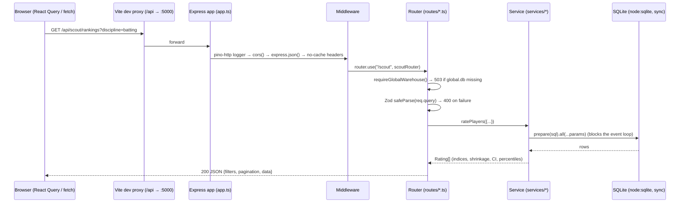

# 08 — API Engineering

> **Server:** Express 5 on Node 24, bundled by esbuild to `artifacts/api-server/dist/index.mjs`. All routes are mounted under `/api` (`src/app.ts:43`). **123 route handlers** in 9 files.
> **Measured:** latency and payload size were recorded on 2026-10-12 against the built bundle on a test port (`PORT=5055 node dist/index.mjs`), warm cache, same machine. “cold” = first call after start-up; “warm” = median of 3. These are single-user laptop numbers, **not** production benchmarks.

---

## 1. How a request flows through the server



Middleware stack (`src/app.ts`): `pino-http` (logs method, path without query, status, time) → `cors()` (**all origins**) → `express.json()` → `express.urlencoded()` → `Cache-Control: no-store` on every `/api` response → routers → static SPA fallback if `ipl-analytics/dist/public` exists.

Start-up (`src/index.ts`): listen on `PORT` (default 5000), then **warm eight decision caches synchronously** (measured 11.9 s, during which requests queue).

---

## 2. Conventions (and where they are broken)

| Convention | Followed by | Broken by |
|---|---|---|
| Zod validation, `400 { error: "invalid_request", issues }` | `decision.ts`, `decision-intel.ts`, `scout.ts` | **all `ipl.ts` routes** (no validation; any string accepted — `/api/stats/query?season=2099` returns 200 with empty arrays after 2.8 s) |
| `503 { error: "warehouse_unavailable" }` when a DB is missing | decision, scout | ipl.ts silently falls back to JSON or literals |
| Stable error codes (`player_not_found`, `unknown_team`, …) | decision, scout | ipl.ts returns `500 { error: err.message }` — leaks internal messages |
| Read-only data access | everything **except** `/ipl/insights/go/:slug` (click counter) and `/ipl/sync-csv` (reads server files — see §9) | |
| Response caching | cricbuzz/news (30 s in-memory TTL) | every API response carries `no-store`, so browsers/CDNs can never cache even immutable historical stats |

---

## 3. Endpoint reference

Legend — **Val**: Zod-validated ✅ / none ❌. **Test**: ✅ automated test exists · 🔵 called during this audit and returned the stated status · ❔ not exercised.

### 3.1 Health — `routes/health.ts`

| Method | Path | Purpose | Val | Measured | Test |
|---|---|---|---|---|---|
| GET | `/api/healthz` | Liveness `{status:"ok"}` (validated by generated Zod schema) | ✅ | 5 ms | 🔵 |

### 3.2 Scout Lab — `routes/scout.ts` → `services/scout/scout-service.ts` → `global.db` (read-only)

| Method | Path | Params (validation) | Response | Errors | Measured (warm) | Test |
|---|---|---|---|---|---|---|
| GET | `/api/scout/search` | `q` (string, trimmed; empty → `[]`) | `{results:[{player_key,cricsheet_id,name,unique_name}]}` (≤15, `LIKE %q%`) | 503 | 5 ms | 🔵 |
| GET | `/api/scout/rankings` | `discipline` batting\|bowling; `competitions` csv; `phase` all\|powerplay\|middle\|death; `role`; `minBalls` 0–10000 (def 120); `recentSeasons` 1–20; `page`; `limit` 1–100; `sortBy`; `sortOrder` asc\|desc; `search` | `{filters, pagination:{total,page,limit,totalPages}, data: Rating[] + strengths/weaknesses}` | 400 `invalid_parameters` (🔵 `minBalls=abc` → 400), 503 | 35 ms batting; 141 ms bowling death; 36 KB | 🔵 (service tested in `scout/tests/api.test.ts`) |
| GET | `/api/scout/player/:id` | key, Cricsheet id or exact name; ambiguous names return candidates | profile: attributes w/ provenance, season lines, roles, trends, similar players, IPL appearances | 404 when no single player resolves (`scout.ts:199`), 503 | **552 ms**, 20 KB | 🔵 |
| GET | `/api/scout/compare` | `ids` 2–5 | side-by-side metrics + deltas | 400, 503 | 85 ms | 🔵 |
| GET | `/api/scout/roles` | — | role catalogue, definitions, thresholds, active counts | 503 | 64 ms (268 ms cold) | 🔵 |

**Known defects:** `minBalls` not applied to the list; default bowling sort puts worst economy first; `unique_name` type error (`:123`). See Chapter 6 §1.10–1.11.

### 3.3 Decision Intelligence (Phase 1–2) — `routes/decision.ts` → `services/decision/*` → `sqlite.db` (read-only)

| Method | Path | Purpose | Validation | Measured | Test |
|---|---|---|---|---|---|
| GET | `/api/players/:id/summary` | merged metadata, career, seasons, phases, top matchups | id resolved by `resolvePlayerId` | 3 ms (32 cold) | 🔵 |
| GET | `/api/optimizer/franchises` | squads available for a season | `season` 4-digit + exists | ❔ | ❔ |
| POST | `/api/optimizer/playing-xi` | MILP Playing XI | `playingXiSchema` (teamId, pitch enum, overseas ≤ 11, locks/excludes, overrides…) | ❔ | ❔ |
| POST | `/api/ask` | natural-language question → `StatQuery` → answer | `question` 2–300 chars | 78 ms (UI-observed) | 🔵 via UI |
| POST | `/api/ask/run` | run an edited structured query | strict `statQuerySchema` (perspective, metric enum from `METRICS`, groupBy, filters…) | ❔ | ❔ |
| GET | `/api/history/overview` | warehouse coverage + live health checks | — | 2 ms | 🔵 |
| GET | `/api/players/search?q=` | player picker | — | 2 ms | 🔵 |
| GET | `/api/weakness/:id` | Hidden Weakness Detector | `window`, `side` | 14 ms | 🔵 (404 for unknown id) |
| GET | `/api/pressure/leaders` | Pressure leaderboards | `window`, `side` | 8 ms | 🔵 |
| GET | `/api/pressure/:id` | Pressure Genome profile | | 2 ms | 🔵 |
| GET | `/api/insights/daily?date=` | five deterministic discoveries for a date | `date` | 2 ms | 🔵 |
| GET | `/api/insights/pool/:category` | full candidate pool | category enum | ❔ | ❔ |

### 3.4 Decision Intelligence (Phase 3–4, page intel, Dugout) — `routes/decision-intel.ts`

| Method | Path | Purpose | Validation highlights | Measured | Test |
|---|---|---|---|---|---|
| GET | `/api/decision/catalog` | teams/venues/seasons for pickers | — | ❔ | ❔ |
| GET | `/api/strategy/setup` | batting/bowling squads for a chase | `battingTeam`, `bowlingTeam`, `season` (2008–2100, must exist) | ❔ | ❔ |
| POST | `/api/strategy/simulate` | Monte Carlo chase, ranked bowling plans | target 1–400, runs, balls 0–119, wickets 0–9, attack 2–8, oversUsed ≤ 4, sims 200–5000, seed | ❔ | ❔ |
| GET | `/api/alt-universe/matches` | match picker | `q` ≤ 80, `season`, `limit` ≤ 100 | ❔ | ❔ |
| GET | `/api/alt-universe/match/:id` | innings snapshot | | ❔ | ❔ |
| POST | `/api/alt-universe/simulate` | what-if (swap bowler / bowling type) | discriminated union on `change.type` | ❔ | ❔ |
| GET | `/api/replay/matches`, `/api/replay/:matchId` | Captain’s Decision Replay | | ❔ | ❔ |
| GET | `/api/opposition` | pre-match exploit map + full-match sim | `team`, `opponent`, `venue`, `season`, `sims` 200–4000 | 233 ms (389 cold) | 🔵 |
| GET | `/api/pool/:id` | Player Pool similarity graph | `side`, `window` | ❔ | ❔ |
| GET | `/api/squad-dna/teams` · `/profile` · `/compare` | Squad DNA | `team`, `season`, `a/b` | 6 ms (profile) | 🔵 |
| GET | `/api/war-room/board` | Auction board | `view` backtest\|live, `team`, `role`, `overseas`, `maxPrice` 20–5000, `signal`, `q`, `sort` | 3–4 ms, 94–156 KB | 🔵 |
| GET | `/api/war-room/player/:key` | Valuation detail + comparables | `view` | ❔ | ❔ |
| GET | `/api/intel/player/:key` · `/team/:key` · `/venue/:key` · `/match/:id` | Intelligence panels on profile pages | | 59 ms (player) | 🔵 |
| GET | `/api/dugout/franchise` | franchise record, titles, H2H, captain | `team` 1–40, `rival` | 2 ms | 🔵 |
| GET | `/api/dugout/squad` | one season’s squad | `team`, **`season` required** (4 digits) | 🔵 400 without `season` | 🔵 |

### 3.5 Legacy IPL analytics — `routes/ipl.ts` → `services/stats-aggregator.ts` + others (no Zod)

| Group | Paths | Source | Notes |
|---|---|---|---|
| Overview & lists | `/api/ipl/overview`, `/seasons`, `/toss-analysis`, `/phase-analysis`, `/batsmen`, `/batsmen/impact`, `/batsmen/boundaries`, `/bowlers`, `/bowlers/death-specialists`, `/teams`, `/teams/head-to-head`, `/teams/championship`, `/venues`, `/records`, `/run-distribution`, `/dismissals`, `/top-batters`, `/top-bowlers`, `/matches`, `/current-squads`, `/squads-by-season`, `/player-auctions`, `/captains`, `/points-tables`, `/player-career-stats`, `/player-team-stats`, `/player-season-stats`, `/player-team-season-stats`, `/player-images`, `/player-photo-registry`, `/season-tops` | mostly `readDataJson()` → `ipl-analytics/public/data/*.json`; `/overview` uses SQL | 🔴 `/ipl/overview` mixes SQL with **hardcoded literals**: `battingFirstWinPct 43.2` (data: 45.3), `chasingWinPct 56.8`, `avgSecondInningsScore 150`, `dotBallPct`, `totalBatsmen 703`, `totalBowlers 550`; `totalSeasons` = 20 (counts a synthetic “All” row). Its JSON fallback literals swap fours and sixes. `/top-batters` returns **1.2 MB**. |
| Team / venue analytics | `/api/ipl/team-analytics`, `/venue-analytics`, `/matchup-opponents` | `team-analytics.ts` | |
| Advanced Stats engine | `/api/stats/query`, `/stats/drilldown`, `/stats/matchup`, `/stats/scenario`, `/stats/player`, `/stats/team`, `/stats/venue` **and duplicates** under `/api/ipl/stats/*` | `aggregateQueryStats` (SQL path or JSON-replay path) | Unfiltered query short-circuits to career JSON (11 ms, 428 KB). **Season-filtered: 2.3 s warm, 492 KB; 10 concurrent: 24 s.** No validation. |
| Generic resources | `/api/players`, `/teams`, `/matches`, `/matchups`, `/venues`, `/stat-builder`, `/scenario-intelligence` | aggregator | |
| Match | `/api/ipl/match/:matchId/scorecard` (404 if no raw file), `/commentary` | `match-card.ts` from raw Cricsheet JSON + ESPN commentary | 2 ms / 4 ms |
| Content | `/api/ipl/insights`, `/insights/go/:slug` (**writes** click count, then redirects), `/insights/clicks`, `/content/hub`, `/content/business`, `/news` | `insights.ts`, `content-hub.ts`, `news.ts` | `/news` 878 ms cold (RSS), 3 ms cached |
| Sync | **POST `/api/ipl/sync-csv`** | `cricsheet-csv-sync.ts` | 🔴 **reads any file path supplied in the body** — §9 |

### 3.6 Live — `routes/live.ts` → `services/cricbuzz.ts`, `news.ts`

| Path | Purpose | Notes |
|---|---|---|
| `/api/live/matches`, `/live/ipl/matches` | live scores (scraped) | 30 s cache; **`?refresh=true` bypasses the cache for any caller**; 502 `live_source_unavailable` on failure |
| `/api/live/news` | ESPN RSS by category | category whitelisted |
| `/api/live/orange-cap`, `/purple-cap`, `/trending`, `/venue-insights/:venueId` | scraped | |
| `/api/live/win-probability/:matchId` | archived matches → calibrated chase model; otherwise scraped | replaced an earlier sine-wave fake (comment in `onlineDb.ts`) |
| `/api/live/match-details/:matchId` | team sheets + commentary from `match-card.ts` | previously returned invented squads (documented in `onlineDb.ts:1-10`) |

### 3.7 Auction game — `routes/auction.ts` → `services/auction.ts`

`GET /state`; `POST /start`, `/select-team`, `/bid`, `/pause`, `/resume`, `/chat`, `/create-room`, `/join-room`, `/set-speed`, `/reset` under `/api/auction`.

🔴 **One global `AuctionEngine` instance** (`services/auction.ts:429`) holds the state for *all* visitors. Two people on the site share one auction; anyone can `POST /reset`. Fine for a single-player demo; unsafe for a public site.

### 3.8 Clip router — `routes/clip-router.ts`

| Path | Purpose |
|---|---|
| POST `/api/get-clip-route` | maps a free-text query to a highlight clip: keyword matcher, or Gemini 1.5 Flash if `GEMINI_API_KEY` is set on the server |
| GET `/api/get-clip-catalog` | the clip catalogue |

---

## 4. Example request / response

```http
GET /api/scout/rankings?discipline=batting&limit=1 HTTP/1.1
```

```jsonc
{
  "filters": { "discipline": "batting", "competitions": ["ipl","smat","bbl","sa20","cpl","ilt20"], "phase": "all", "minBalls": 120, … },
  "pagination": { "total": 3435, "page": 1, "limit": 1, "totalPages": 3435 },
  "data": [{
    "player_key": 456, "cricsheet_id": "470f446b", "name": "V Suryavanshi", "competition": "ipl",
    "seasons": ["2025","2026"], "balls": 449, "tier": "rankable",
    "counts": { "runs": 1028, "boundaries": 177, "dots": 154, "dismissals": 23 },
    "metrics": {
      "strike_rate": { "value": 228.95, "league": 155.31, "index": 147.42,
                       "ci": [137.44, 157.39], "shrunk": 137.42, "percentile": 100, "population": 289 },
      …
    },
    "role": { "label": "opener", "inputs": { "innings": 23, "openShare": 1, "medianPosition": 2, … } },
    "teams": ["Rajasthan Royals"], "strengths": ["Strike rate 229.0 vs league 155.3 (100th pct of 289)", …]
  }]
}
```

```http
GET /api/scout/rankings?minBalls=abc  →  400
{ "error": "invalid_parameters", "issues": [ { "code": "invalid_type", "path": ["minBalls"], … } ] }
```

---

## 5. Contracts between front end and back end

- An **OpenAPI 3.1 spec** exists (`lib/api-spec/openapi.yaml`, 19 paths, Orval config) and generates `lib/api-zod` and `lib/api-client-react`. **The web app imports neither** — it uses hand-written clients (`src/lib/scout-api.ts`, `sim-api.ts`, `discovery-api.ts`, `ask-api.ts`, `dugout-api.ts`, `aggregates.ts`, `live.ts`). Only `/healthz` uses a generated schema.
- Consequence observed in this audit: the Scout API returns `role` as an object while the UI treats it as a string → every row shows “Unclassified”. A shared, generated type would have made this a compile error.

---

## 6. Performance summary (measured)

| Class | Examples | Warm latency | Why |
|---|---|---|---|
| Pre-computed / cached | `/players/:id/summary`, `/war-room/board`, `/pressure/*`, `/insights/daily`, `/dugout/*` | 2–14 ms | decision caches built at start-up |
| Light SQL over aggregates | `/scout/rankings`, `/scout/compare` | 35–141 ms | `global.db` aggregates |
| Heavier profile | `/scout/player/:id` | 552 ms | repeats `ratePlayers` per season for lines + trends + similar (N+1-style) |
| Simulation | `/opposition` | 233 ms | Monte Carlo |
| **Legacy Advanced Stats** | `/stats/query?season=2025` | **2.3 s**; 10 parallel → **24 s** | multi-join SQL + JSON replay, synchronous |
| Static JSON passthrough | `/ipl/top-batters` | 30 ms but **1.2 MB** | no pagination |
| Concurrency (Scout) | 50 parallel `/scout/rankings` | 1.9 s wall | event loop serialises synchronous SQLite |

---

## 7. Authentication and authorisation

**None.** Every endpoint is public, including state-changing ones (`/auction/*`, `/ipl/insights/go/:slug`, `/ipl/sync-csv`) and the photo-pipeline admin page in the front end. CORS allows any origin.

---

## 8. How to design, debug, test and extend an endpoint (worked recipe)

1. **Design:** write the Zod schema first (input contract). Decide the error codes (400/404/503). Decide the response shape and add it to the OpenAPI spec so a typed client is generated.
2. **Implement:** route handler stays thin: validate → call one service function → map result/null to status codes.
3. **Debug:** `curl -s "http://localhost:5055/api/…" | jq` ; read `pino` logs (`preview_logs` or the terminal); reproduce with the service function directly in a `tsx` script (as done in this audit for `ratePlayers`, `auctionBoard`).
4. **Test:** service-level `node:test` (pattern: `scripts/src/scout/tests/scout.test.ts`); add an HTTP-level test with `supertest` against `app` (not present in the repo today).
5. **Extend:** e.g. adding `GET /api/scout/leaders?metric=boundary_pct` = new Zod schema + call `ratePlayers` + sort by the metric’s **direction** (the bug in §3.2 shows why direction must be explicit).

---

## 9. Security findings specific to the API

| # | Finding | Severity | Evidence | Fix |
|---|---|---|---|---|
| S1 | **Arbitrary server-file read**: `POST /api/ipl/sync-csv` takes `filePath` from the request body, checks `fs.existsSync(filePath)` and reads it; a missing file returns an error containing the path (existence oracle). No auth. | **High** | `routes/csv-sync-route.ts:6-36`, `services/cricsheet-csv-sync.ts:38-43`. *Not exploited during the audit.* | Delete the route, or accept only an id that maps to a whitelisted file under `ipl_csv/`. |
| S2 | Shared mutable game state; public `/auction/reset` | Medium | `services/auction.ts:429` | per-session state keyed by a session id |
| S3 | Cache bypass `?refresh=true` lets anyone trigger unlimited outbound scraping | Medium | `routes/live.ts` | remove for public callers; rate-limit |
| S4 | No rate limiting; a few concurrent `/stats/query` calls block the server for tens of seconds | Medium (availability) | measured | rate-limit + move heavy queries to precomputed tables / worker |
| S5 | `500 { error: err.message }` leaks internals | Low | `ipl.ts`, csv-sync | log details, return generic code |
| S6 | Open CORS | Low (no cookies/auth) | `app.ts:28` | restrict to the site origin |
| S7 | Gemini key in browser localStorage / query string (client-side) | Low–Medium | `lib/gemini-client.ts` | proxy through the server; never send keys from the browser |
