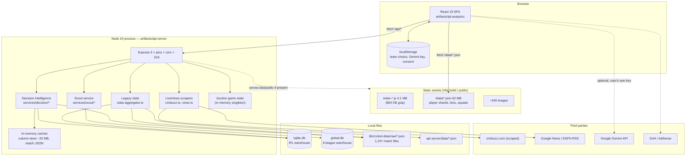
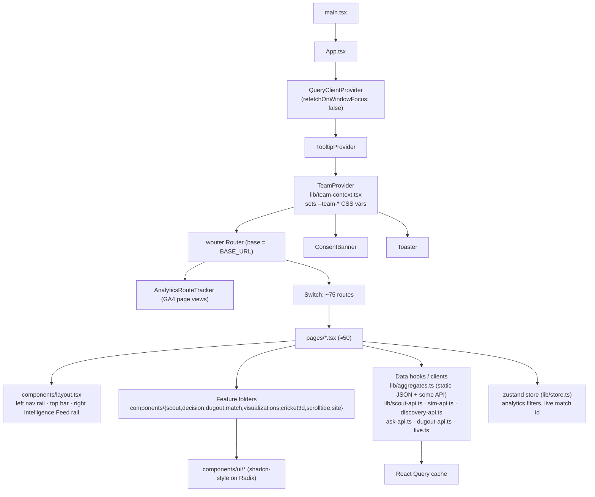
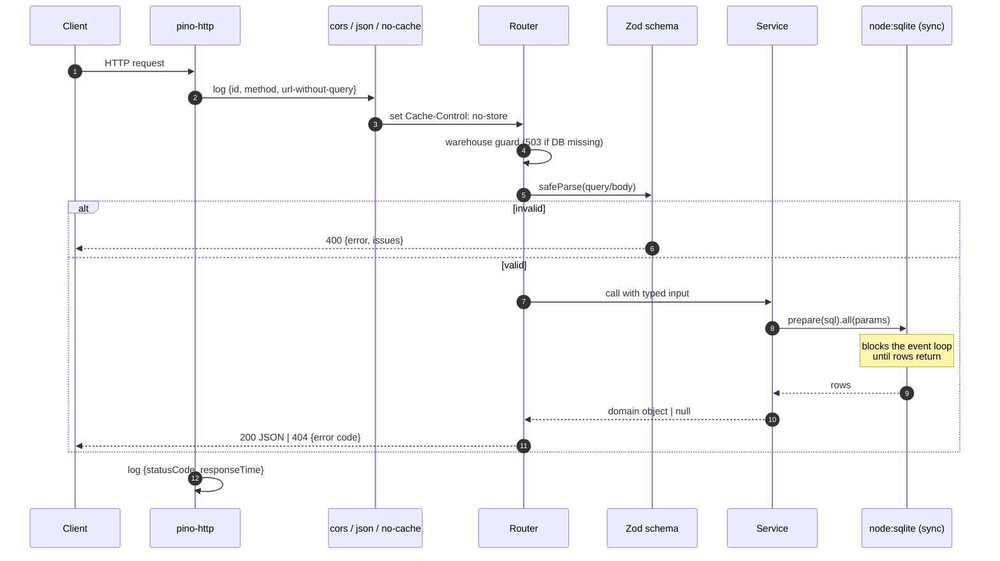
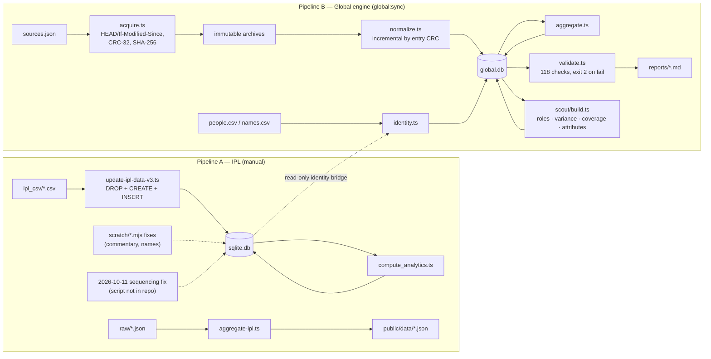
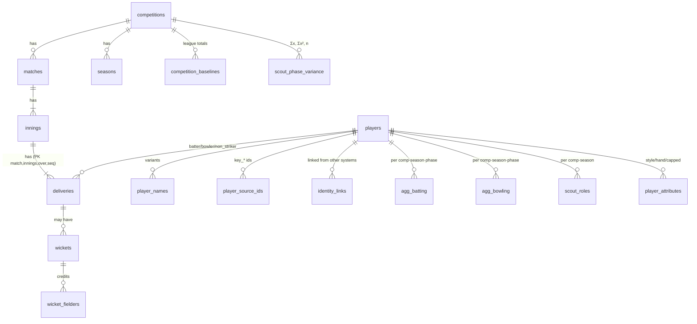
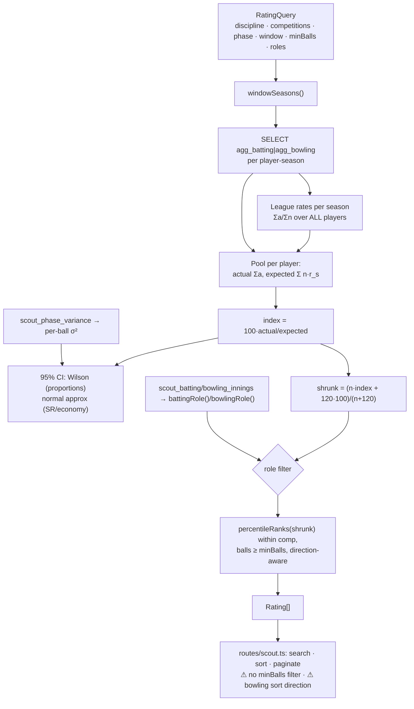
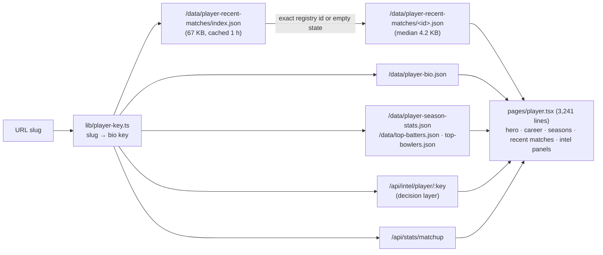
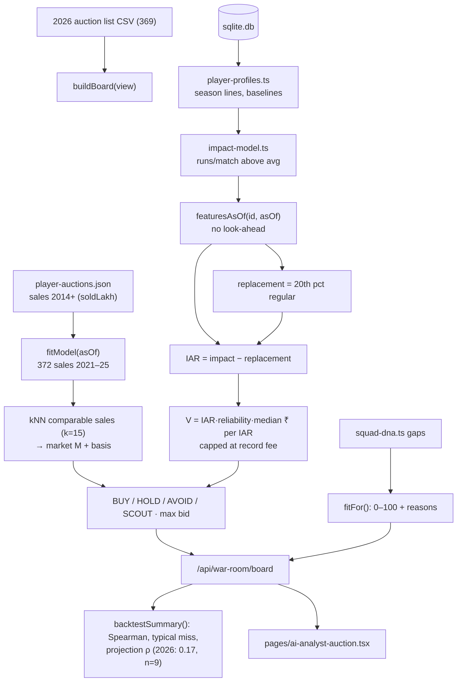
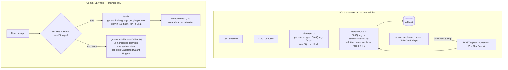
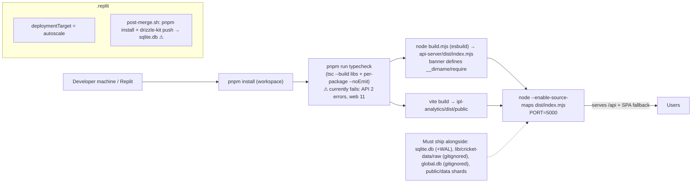

# Architecture Diagrams

All ten diagrams are Mermaid (render on GitHub, VS Code with a Mermaid extension, or mermaid.live). Each is followed by the files it describes, what moves across it, and where its boundaries are. Diagrams describe the code **as it is on 2026-10-12**, including the uncommitted Scout Lab work.

---

## 1. High-level system architecture

**Files:** `artifacts/ipl-analytics/src/App.tsx`, `artifacts/api-server/src/{index,app}.ts`, `routes/index.ts`.
**Movement:** the browser pulls both *static JSON* (precomputed at build time) and *API JSON* (computed per request). Only the API touches SQLite.
**Boundaries:** one Node process does everything (HTTP, SQL, simulation, scraping). No queue, no worker, no separate DB server, no auth layer. The Gemini call is made **from the browser**, outside the server boundary.

---

## 2. Front-end component architecture

**Files:** `App.tsx`, `components/layout.tsx`, `lib/*.ts`.
**Data movement:** pages call hooks; hooks call `fetch` and cache in React Query (keys like `["agg","top-batters"]`, `staleTime` 1 h for static JSON). Global UI state (chosen franchise) lives in React context + localStorage; filter state on Advanced Stats in zustand.
**Boundaries:** there is **no code splitting** — every page is imported statically into `App.tsx`, so the whole site ships in one 4.1 MB bundle.

---

## 3. Back-end request lifecycle

**Files:** `src/app.ts`, `routes/scout.ts` (exemplary), `routes/ipl.ts` (no Zod; `500 {error: err.message}`).
**Boundary to remember:** because the SQLite driver is synchronous, “concurrent” requests are processed one after another; measured 10 parallel Advanced Stats queries → 24 s.

---

## 4. Data ingestion and ETL pipeline

**Files:** `scripts/src/update-ipl-data-v3.ts`, `compute_analytics.ts`, `aggregate-ipl.ts`, `scripts/src/global/*.ts`, `scripts/src/scout/*.ts`.
**Boundary:** Pipeline B never writes to `sqlite.db`. Pipeline A is not reproducible from the repo (Chapter 5 §8).

---

## 5. Database relationships

This is the **global** warehouse (the IPL warehouse ERD is in Chapter 4 §3.3). Every aggregate has the same grain as its league baseline, which is what makes `index = 100 × actual / expected` a simple join.

---

## 6. Scouting engine processing

**Files:** `services/scout/scout-service.ts:269-489`, `routes/scout.ts:78-188`.

---

## 7. Player profile data flow (`/players/:slug`)

**Why it matters:** before Step 3 the page loaded one 33 MB JSON for every player and crashed; now it loads a 67 KB index + one shard. The identity rule is exact-only, so an unverified bio shows an empty state instead of another player’s matches.

---

## 8. War Room data flow

---

## 9. AI Analyst request flow

**Files:** `routes/decision.ts:138-171`, `services/decision/nl-parser.ts`, `stats-engine.ts`, `ipl-analytics/src/lib/gemini-client.ts`.

---

## 10. Deployment and build process

**Facts:** root `build` = typecheck then `pnpm -r build`, so a failing typecheck blocks a clean build. The API bundle was last built 2026-10-12 15:50. There is **no CI** (no `.github/workflows`), **no container**, **no Vercel config**. Autoscale hosting with a local SQLite file means each instance has its own copy; writes (click counter, auction state) are not shared between instances.
