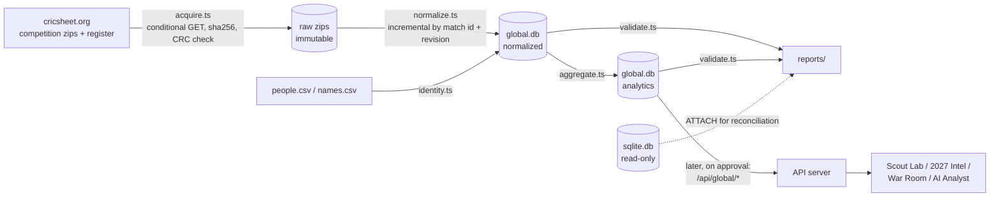

# Global Cricket Data Engine — audit and acquisition plan

Status: **plan only, awaiting approval.** Nothing has been downloaded, migrated, overwritten or deleted.
Audit date: 2026-10-10. Everything below was measured on this machine unless marked as from the Cricsheet catalogue.

What was done to produce this report:

- Read-only inspection of the repository, `sqlite.db` and the JSON data products.
- Header-only (`HEAD`) requests to Cricsheet for archive sizes. One 400-byte range read of the `people.csv` header to compare columns. No files were saved.
- A throwaway prototype built in the session scratch folder (not in the repo). It loaded the IPL raw JSON already on disk into the proposed lean schema to measure storage per ball.

---

## 1. Audit of the existing IPL data

### 1.1 Directory tree (data-relevant parts only)

```
Data-Insight-Engine/
├─ sqlite.db                    112 MB warehouse (+84 MB WAL). Tracked in git.
├─ ipl_csv/                     1,243 Cricsheet "original" CSV match files, 31 MB. Tracked in git.
│                               → input to the warehouse build
├─ lib/cricket-data/
│  ├─ raw/                      1,243 Cricsheet JSON files (format 1.2.0), 112 MB on disk. Gitignored.
│  │                            → read at API start-up (targets, stages, stumpings) and by aggregate-ipl.ts
│  └─ aggregated/               14 JSON files, 4.7 MB. Stale: 9 of 14 differ from the copies actually served.
├─ people.csv                   Cricsheet people register (18,298 people). Not used by any active pipeline.
├─ players-data-updated.csv     772 IPL players with bat/bowl style. Read at runtime by player-profiles.ts.
├─ 2026 ipl auction player list*.csv / .xlsx   Official auction list (eligibility source).
├─ scripts/src/
│  ├─ update-ipl-data-v3.ts     Builds sqlite.db from ipl_csv/. Drops every table and rebuilds.
│  ├─ aggregate-ipl.ts          raw JSON → lib/cricket-data/aggregated + public/data
│  └─ compute_analytics.ts …    Older Drizzle-era scripts
├─ scratch/build-delivery-commentary.mjs   ESPN commentary joined onto deliveries → delivery_commentary
├─ artifacts/api-server/
│  ├─ data/                     23 JSON products, 14 MB, served by /api/ipl/*
│  └─ src/services/decision/    Warehouse readers: db.ts, ball-context.ts (typed-array column store),
│                               stats-engine.ts, player-profiles.ts, dugout-data.ts …
└─ artifacts/ipl-analytics/public/data/   29 files, 52 MB. Byte-identical copies of the 23 API files, plus
                                          player-recent-matches.json (34 MB) and ball-commentary.json (4.6 MB)
```

You described "~28 CSV datasets". They are actually the **29 JSON data products** in `public/data`, 23 of which are duplicated in `api-server/data`. The CSV assets are the following:

- the 1,243 per-match files in `ipl_csv/`
- `people.csv`
- `players-data-updated.csv`
- the 2026 auction list
- `scratch/espn-player-data.csv`

### 1.2 Current architecture

```mermaid
flowchart LR
  subgraph Sources
    CSV[ipl_csv/*.csv<br/>Cricsheet original CSV]
    JSON[lib/cricket-data/raw/*.json<br/>Cricsheet JSON 1.2.0]
    ESPN[ESPN commentary<br/>scratch pipeline]
    CUR[Hand-curated JSON<br/>players, squads, auctions, captains, bios]
  end
  CSV -->|update-ipl-data-v3.ts<br/>drop + rebuild| DB[(sqlite.db)]
  ESPN -->|build-delivery-commentary.mjs| DB
  JSON -->|aggregate-ipl.ts| AGG[JSON products]
  CUR --> AGG
  AGG --> APIDATA[api-server/data] & PUB[public/data]
  DB -->|node:sqlite read-only| COL[ball-context.ts<br/>typed-array column store]
  JSON -->|runtime scan:<br/>targets, stages, stumpings| COL
  COL --> DEC[Decision OS services<br/>/api/stats, /api/intel, /api/dugout …]
  APIDATA --> IPLAPI[/api/ipl/*]
  IPLAPI -->|fallback| PUB
  DEC & IPLAPI & PUB --> WEB[Vite/React site]
```

How the data is loaded and queried:

1. `aggregates.ts` on the site calls `/api/ipl/<name>`. If that fails it falls back to `/data/<name>.json`.
2. Some files are always fetched statically: `player-bio`, `player-latest-teams`, and the 34 MB `player-recent-matches`.
3. Decision OS pages call `/api/stats|intel|dugout|squad-dna|…`. Those services read a single read-only `node:sqlite` connection (`db.ts`).
4. On first use they build an in-memory column store (`getBallColumns`). Most modules scan it rather than query SQLite.

### 1.3 Schema inventory (`sqlite.db`)

| Table | Rows | Notes |
|---|---:|---|
| deliveries | 295,732 | 30 cols. `pressure_state`, `required_rr` and `current_rr` are placeholders. `ball_num` restarts after the 9th ball of an over. |
| delivery_commentary | 293,652 | ESPN text, line/length/shot/zone. `speed_kph` present on 7,173 balls only. IPL only. |
| dismissals | 14,705 | `fielder_id` NULL on every row, although the raw JSON names fielders. |
| innings | 2,514 | Super overs are innings 3–6, with no flag. |
| matches | 1,243 | `match_type` is "T20" everywhere. `status` is "Finished" everywhere. Stage is not stored. |
| players | 1,141 | `cricsheet_id` UNIQUE. 964 are real 8-hex registry ids and 177 are synthetic `json:N` (squad-only, 0 balls). *(Corrected during Batch 1: the audit first said 1,119 / 22 because it counted ids by length, and `json:NNN` is also 8 characters.)* `country` is "Unknown" and styles are NULL on every row. |
| teams / venues | 19 / 60 | Renamed franchises have several team ids. Venues are name-normalised, with no registry ids. |
| fact_batting_innings / fact_bowling_spells | 18,842 / 14,734 | Spells wrongly credit "retired out" (known issue). |
| player_* aggregates | 804–31,370 | Career, season, team, phase and matchup tables. |
| empty | 0 | `auction_roi`, `partnerships`, `dim_scenario`, `dim_team_match_bridge` |

There are 29 indexes. Two are redundant:

- `dismissals(player_out_id)` is indexed twice.
- `idx_deliveries_match_id` (4.4 MB) is a prefix of two other composite indexes.

### 1.4 File sizes and duplication

| Asset | Size | Duplication |
|---|---:|---|
| `sqlite.db` | 112 MB + 84 MB WAL | Deliveries + indexes ≈ 53 MB; commentary + indexes ≈ 60 MB. The 112 MB main file is in git and exceeds GitHub's 100 MB file limit. |
| `lib/cricket-data/raw` | 112 MB (100.6 MB of JSON) | Same 1,243 matches as `ipl_csv/` (31 MB) in a second format. |
| `api-server/data` | 14 MB | All 23 files byte-identical in `public/data`. |
| `public/data` | 52 MB | Includes `player-recent-matches.json` at 34 MB, fetched whole by `pages/player.tsx:117`. |
| `lib/cricket-data/aggregated` | 4.7 MB | Stale and divergent (9 of 14 differ). |

### 1.5 What works well

- Players are keyed by the Cricsheet registry ID (`cricsheet_id UNIQUE`). That ID is stable across every Cricsheet competition, so it is the right canonical key for cross-league identity. No name matching is needed for Cricsheet performance data.
- The warehouse reconciles exactly with the raw files. The prototype re-ingested the on-disk JSON and matched the warehouse on every total:
  - balls 295,732
  - runs 401,738
  - batter runs 381,529
  - extras 20,209
  - wides 9,876
  - wickets 14,705
  - innings 2,514
  - 0 matches with differing run totals
- The typed-array column store scans every ball in milliseconds once warm.
- Queries compile to a typed `StatQuery`, never to LLM-written SQL.
- The site keeps working through the API → static JSON fallback.

### 1.6 Bottlenecks and risks

| # | Finding | Measured |
|---|---|---|
| B1 | The column store builds cold on first request. | 4.0 s for 295,557 balls, 117 MB RSS. Loading ~2.3 M global balls into the same structure would take roughly 30 s and hold ~250 MB. |
| B2 | The API scans all 1,243 raw JSON files (112 MB) at start-up for targets, stages and stumpings, because the warehouse doesn't store them. | — |
| B3 | Information in the raw JSON is dropped by the warehouse. | Fielders on 10,721 dismissals (11,266 names); 557 impact-player and 6 concussion replacements; 990 DRS reviews; powerplays on 2,480 innings; targets; stages; the super-over flag. |
| B4 | Per-ball text columns (`delivery_type`, `scoring_area`, `pressure_state`, `phase`). | Deliveries + indexes ≈ 53 MB. The lean prototype stores more information in 18.3 MB. |
| B5 | Full drop-and-rebuild ETL. | No manifest, no hashes, no incremental mode. Root `pnpm update-ipl-data` wipes all tables. |
| B6 | Three copies of the JSON products, one of them stale. | Risk of drift; no single source of truth. |
| B7 | A 34 MB static JSON is shipped to the browser for the player page. | Largest page-load cost on the site. |
| B8 | 177 squad-only players have synthetic ids (corrected from 22), and some may duplicate registry players. | For example, "Wanindu Hasaranga" (`json:8`, 0 balls) versus the registry name "PWH de Silva". "Mayank Agarawal" is a typo. |
| B9 | Docs drift. | `DATA_FLOW.md` and `DATABASE_ARCHITECTURE.md` describe PostgreSQL + Drizzle; the live path is `node:sqlite`. |

### 1.7 Recommended compatible improvements to the existing IPL stack

These are not part of the global work. Each needs your separate approval, because each touches existing data, git or pages.

| # | Change | Benefit |
|---|---|---|
| R1 | Serve recent matches per player from the API instead of the 34 MB file. Small change to `pages/player.tsx`. | Removes ~34 MB from player-page loads. |
| R2 | Stop tracking `sqlite.db` in git (it is rebuilt by script). | Removes a 112 MB file that GitHub will reject. |
| R3 | Drop the two redundant indexes. | About 5 MB smaller; faster writes. |
| R4 | Generate `public/data` from `api-server/data` at build time and delete the stale `aggregated/` copy. | One source of truth. |
| R5 | Once `global.db` exists, read targets, stages, fielders and replacements from it instead of scanning raw JSON at start-up. | Faster cold start; fielding data becomes available. |
| R6 | Correct the outdated architecture docs. | Accuracy. |

---

## 2. Cricsheet source verification

Read from <https://cricsheet.org/downloads/>, `/register/`, `/licensing/` and `/format/json/` on 2026-10-10.

- **Licence:**
  - Match data is under the **Open Data Commons Attribution License (ODC-BY 1.0)**.
  - XML match data alone is under CC BY 4.0.
  - The register page says the People and Venue registers are under ODC-BY.
  - Any public use must be attributed and the licence made clear. The Data Sources page already credits Cricsheet under ODC-BY for IPL. It will need to list each new competition once global data is shown publicly; that page change needs your approval.
- **Formats:**
  - JSON is the primary format; YAML is legacy.
  - CSV ("original" and "new"/CSV2) and XML are offered as experiments.
  - JSON is the richest: it keeps replacements, reviews, powerplays, targets, officials, events and registry ids. This plan uses JSON only.
- **Current JSON format is 1.3.0, which adds `registry.venues` (stable venue ids).** The IPL files on disk are all 1.2.0.
- **Stable identifiers:** `registry.people` and `registry.venues` map names to 8-character hex ids, "stable across matches". The people register (`people.csv`, `names.csv`) links them to other sites' ids: `key_cricinfo`, `key_bcci`, `key_bigbash`, `key_pulse` and others.
- **Not in Cricsheet data:** bowling style, batting hand, nationality, date of birth, fielding positions, ball speed, line/length and shot location.
- **Withheld matches:** 379 matches are withheld site-wide. Cricsheet links this to its article on withholding Afghanistan matches. Men's T20Is are affected (163 withheld across genders); the club competitions below show none withheld.
- **Updates:**
  - Archives are rebuilt together on each site rebuild; the last rebuild was 7 Oct 2026 at 17:04–17:16 GMT.
  - Responses carry `Last-Modified` but no `ETag`. A new date therefore doesn't prove the content changed, so changes must be detected by hash and per-match revision.
  - Cricsheet is not a live-score service; this pipeline is for periodic historical refreshes.
- **Download pattern:**
  - Competition archives: `https://cricsheet.org/downloads/{slug}.zip`.
  - Gender variants append `_male` or `_female`; I confirmed `hnd_male_json`, `ssm_male_json` and `t20s_male_json` return 200.
  - Registers: `https://cricsheet.org/register/people.csv` and `names.csv`.

### 2.1 Download list (counts from the catalogue; sizes from HEAD requests)

**Priority 1 — core scouting leagues**

| Competition | Archive | Men's matches | Size | Notes |
|---|---|---:|---:|---|
| IPL | `ipl_json.zip` | 1,243 | 5.19 MB | Same count as the warehouse. Used for comparison only, never as a replacement (§5.4). |
| Syed Mushtaq Ali Trophy | `sma_json.zip` | 695 | 2.70 MB | The only Indian domestic T20 on Cricsheet. |
| Big Bash League | `bbl_json.zip` | 662 | 2.71 MB | |
| SA20 | `sat_json.zip` | 130 | 0.53 MB | |
| Caribbean Premier League | `cpl_json.zip` | 445 | 1.83 MB | |
| ILT20 | `ilt_json.zip` | 134 | 0.58 MB | |
| People + names register | `people.csv`, `names.csv` | 18,298+ people | 1.35 MB | The local `people.csv` has the same columns; it will be refreshed. |
| **Total P1** | | **3,309** (2,066 new) | **14.9 MB** | |

**Priority 2 — additional competitions**

| Competition | Archive | Men's matches | Size | Notes |
|---|---|---:|---:|---|
| Pakistan Super League | `psl_json.zip` | 357 | 1.50 MB | Performance data only. IPL eligibility is a separate question. |
| Bangladesh Premier League | `bpl_json.zip` | 469 | 1.99 MB | |
| Lanka Premier League | `lpl_json.zip` | 143 | 0.62 MB | |
| Major League Cricket | `mlc_json.zip` | 109 | 0.47 MB | |
| The Hundred (men) | `hnd_male_json.zip` | 201 | 0.76 MB | 100 balls, sets of 5 (`balls_per_over` = 5); needs per-ball normalisation. |
| T20 Blast | `ntb_json.zip` | 1,570 | 6.20 MB | |
| Super Smash (men) | `ssm_male_json.zip` | 270 | 1.08 MB | |
| Men's T20Is | `t20s_male_json.zip` | 3,592 | 14.35 MB | Largest archive. Afghanistan matches are withheld, so Afghan players' international records are incomplete. |
| **Total P2** | | **6,711** | **27.0 MB** | |

**Priority 3 — evaluated, not to be downloaded**

- CSA T20 Challenge (`ctc_json`, 314 matches, 1.25 MB). The strongest candidate for South African domestic talent.
- Nepal Premier League (64), Major League Tournament (134), Mzansi Super League (56), Ireland Inter-Provincial T20 (111), unofficial T20Is (240 men's).
- Women's leagues (WPL, WBBL, WCPL, Hundred women).
- ODIs, Tests, multi-day and first-class.

The schema already supports all of these through `competition`, `gender`, `match_type` and `balls_per_over`.

**Not on Cricsheet at all:** Indian state T20 leagues (TNPL, Maharaja Trophy, UP T20 and others) and Indian domestic one-day and first-class cricket. SMAT will be the only source of uncapped Indian T20 talent unless you approve another permitted source.

---

## 3. Proposed architecture

### 3.1 Key decision: a separate `global.db`, not new rows in `sqlite.db`

Every existing IPL module queries `sqlite.db` without a competition filter. `franchiseOf`, `resolveVenue` and the auction model assume IPL team and venue ids, and the column store loads every delivery into memory. Adding BBL or SMAT balls to the existing tables would silently change IPL numbers across the site.

Instead:

- `lib/cricket-data/global/warehouse/global.db` holds all competitions, IPL included, in one competition-aware schema. Its IPL rows are re-ingested from the current Cricsheet archive.
- `sqlite.db` stays the system of record for the existing site. Nothing in it is replaced.
- The two databases join exactly on `players.cricsheet_id`. For reconciliation, `global.db` can `ATTACH` `sqlite.db` read-only.
- Global queries read precomputed aggregates and indexed per-player drill-downs. They never go through the in-memory column store, which stays IPL-only.

### 3.2 Storage options compared

| Option | Verdict |
|---|---|
| Raw JSON kept inside the original zips | **Yes.** Immutable raw layer of about 42 MB. Exploded it would be ~850 MB (IPL's measured ratio is 21:1). |
| SQLite (`node:sqlite`) for normalized + analytics | **Yes.** Same engine and driver as today, no new runtime dependency, `WITHOUT ROWID` composite keys, and `ATTACH` for reconciliation. |
| Precomputed aggregates | **Yes,** inside `global.db`. API responses in milliseconds; nothing large reaches the browser. |
| CSV | Exports only. CSV2 drops replacements, reviews and powerplays. |
| Parquet + DuckDB | **Not now.** It compresses better, but adds a native dependency and a second query engine. Worth revisiting above ~20 M balls (for example if ODIs and Tests are added). |
| PostgreSQL | **No.** The project runs serverless on SQLite. |

### 3.3 Layers and directory layout

```
lib/cricket-data/global/                       (new; raw/ and warehouse/ gitignored)
├─ raw/cricsheet/
│  ├─ archives/<slug>/<lastModified>_<sha8>.zip    immutable; a new file only when the content hash changes
│  └─ register/{people,names}/<date>_<sha8>.csv
├─ manifests/
│  ├─ sources.json        competition catalogue: code, name, slug, URL, gender, format, priority
│  ├─ acquisitions.jsonl  append-only log: url, retrieved_at, last_modified, bytes, sha256, entries, matches
│  └─ coverage.json       generated per competition and season: matches, date range, gaps, withheld notes
├─ warehouse/global.db    normalized + analytics layers (rebuildable from raw)
└─ reports/               validation, IPL reconciliation, identity review, change reports
scripts/src/global/       pipelines (existing convention: tsx scripts in @workspace/scripts)
scripts/test/global/      node:test fixtures and reconciliation tests
docs/global-data-engine/  documentation
```



### 3.4 Normalized schema (Cricsheet-native, competition-aware)

The schema keeps every field the JSON offers. Full DDL goes in `scripts/src/global/schema.sql`.

- `competitions`
  - `competition_id`, `code` (`ipl`, `sma`, `bbl` …), `name`, `region`, `format` (`T20`, `T20I`, `100-ball`), `gender`, `team_type`, `source`, `source_slug`.
- `seasons`
  - `competition_id`, `season_label` (raw, for example "2023/24"), `start_date`, `end_date`, `matches`.
  - IPL keeps its existing alias mapping (2007/08 → 2008 and so on).
- `matches`
  - Key: `match_id` (the Cricsheet match id, unique site-wide; checked during ingest).
  - Context: `competition_id`, `season_label`, `dates`, `gender`, `match_type`, `balls_per_over`, `overs`, `team1_id`, `team2_id`, `venue_id`.
  - Toss and outcome: toss winner and decision, winner, result, method, margins, eliminator.
  - Event: stage, match number, group.
  - Provenance: `data_version`, `revision`, `created`, source archive and entry CRC.
- `teams`
  - Unique by (competition, name).
  - `team_aliases` contains only explicit, sourced entries, such as the IPL renames already listed in `migrate_deliveries.ts`. Nothing is merged automatically.
- `venues`
  - `cricsheet_venue_id` comes from the 1.3.0 registry.
  - `venue_aliases` is used for older files.
- `players`
  - `player_key` and `cricsheet_id` (canonical), plus `name` and `unique_name` from the register.
  - `player_source_ids` holds `key_cricinfo`, `key_bcci`, `key_bigbash` and the other `key_*` columns.
  - `player_names` holds variants from `names.csv` and the name used in each match.
- `match_players`: per match and team, from `info.players`. Supports "matches played" and "associated teams".
- `innings`
  - Batting and bowling team; super-over flag.
  - Target runs and overs (DLS included).
  - Declared, forfeited, penalty runs, absent hurt.
- `powerplays`: from, to, type.
- `deliveries`
  - Key: (match, innings, over, seq), `WITHOUT ROWID`. `seq` is the real order within the over, which fixes the "2.10" bug.
  - Players: batter, non-striker, bowler.
  - Runs: batter, extras, total, `non_boundary`.
  - Extras: wides, no-balls, byes, leg-byes, penalty.
- `wickets`: kind, player out, fielders (names and keys).
- `replacements`: impact player, concussion and other substitutions.
- `reviews`: DRS reviews.
- `match_officials`
- `ingest_runs` and `source_files`: provenance per load.

Measured basis: the prototype stored every IPL ball, wicket, innings and match, plus two player indexes, in **18.3 MB (65 bytes per ball)**. It ingested in 3.4 s, against the current 53 MB of deliveries and indexes.

### 3.5 Analytics layer (precomputed)

**Tables**

- `agg_batting`, keyed by (player, competition, season, phase):
  - innings, balls faced, runs
  - fours, sixes, dots
  - dismissals, not outs
- `agg_bowling`, keyed by (player, competition, season, phase):
  - legal balls, runs conceded, wickets
  - dots, boundaries conceded, wides, no-balls
- `agg_player_opponent` and `agg_player_venue`: the same measures split by opposition team and by venue.
- `competition_baselines`, per (competition, season, phase): run rate, balls per dismissal, boundary %, dot %. Used for league-relative context.
- `agg_percentiles`, by competition × derived role, with minimum samples applied.
- `chase_state`: required rate and wickets in hand for each chase ball. This is the existing `ball-context.ts` logic, generalised to `balls_per_over` and DLS targets.

**Formulas** (one definition in `metrics.ts`, tested)

- **Ball faced:** any delivery that is not a wide. No-balls count as faced.
- **Legal ball:** not a wide and not a no-ball.
- **Strike rate:** 100 × batter runs ÷ balls faced.
- **Batting average:** runs ÷ dismissals (shown as "—" with 0 dismissals).
- **Runs conceded:** batter runs + wides + no-balls. Byes, leg-byes and penalties are not charged to the bowler.
- **Economy:** 6 × runs conceded ÷ legal balls. All formats use per-ball rates, so The Hundred is comparable.
- **Bowler wickets:** bowled, caught, caught and bowled, lbw, stumped, hit wicket. These come from `wickets`, which avoids the known "retired out" mis-credit.
- **Team wickets:** every dismissal except retired hurt.
- **Boundaries:** batter runs of 4 or 6 where `non_boundary` is not set.
- **Batting dot:** a ball faced with 0 batter runs.
- **Bowling dot:** a legal ball with 0 runs conceded.
- **Phases (T20):** overs 1–6, 7–15 and 16–20, the site's existing convention.
- **Phases (Hundred):** balls 1–25, 26–75 and 76–100. This is a documented project convention, and Hundred phases are only compared with other Hundred data.
- **Super overs:** excluded from player stats.

**Safeguards**

- Rankings need at least 120 balls (faced or bowled). Samples of 60–119 are labelled low-confidence; anything smaller is shown without a rank.
- Every rate carries its sample size and an interval: Wilson intervals for proportions, bootstrap for strike rate and economy.
- Percentiles are computed only within one competition and derived role.
- League-relative indices are context, never equivalence. No league-strength multiplier will be used until one is validated against players who moved between leagues.

**Derived, never asserted**

- Role comes from usage: batting position, share of balls in each phase, overs per match.
- Keeper status comes from stumpings.
- These are labelled as derived.

**Not computable from Cricsheet**

- Matchups against pace or spin, against left- or right-arm bowling, and against left- or right-handed batters.
- Nationality.
- These stay NULL for global players. The existing IPL-only sources (`players-data-updated.csv`, ESPN speeds, squad countries) cover IPL players only. A separate licensed or verified enrichment pipeline is a later decision.
- Auction eligibility, registration and availability stay in their own table, sourced only from official auction lists and never inferred from performance.

---

## 4. Player identity resolution

1. **Canonical id = Cricsheet `identifier`.** Every delivery in every archive names players through `registry.people`; the prototype found no unregistered IPL participants. Cross-league aggregation is an exact join on this id.
2. **Bridge to the IPL warehouse.** Exact on `players.cricsheet_id` for the 964 registry-keyed players (corrected from 1,119).
3. **External source ids.** Taken from the `key_*` columns in `people.csv`. They allow exact joins to other permitted sources later.
4. **Name variants.** From `names.csv` plus the name used in each match file. They are used only to generate candidates.
5. **Never merged on name alone.** The 177 synthetic `json:N` IPL players (corrected from 22) and any name that maps to two or more ids within the loaded competitions go to `identity_review_queue`, with candidate ids and evidence (`names.csv` hits, team and season overlap). Nothing is linked until a decision is recorded.
6. **Audit trail.** `identity_links` records player, source, source key, method (`cricsheet_registry`, `people_key` or `manual`), confidence, decided_by, decided_at and a note.
7. **Collision report.** Every build lists names shared by several people (`people.csv` `name` is not unique; `unique_name` is). Display names use `unique_name`.

Example query this enables: "batting for player X across IPL, SA20 and CPL" becomes `agg_batting WHERE player_key = X GROUP BY competition`. It is exact by construction.

---

## 5. Pipeline behaviour

### 5.1 Acquisition (`acquire.ts`)

- Takes URLs only from `sources.json` (the catalogue slugs above) and downloads one at a time, with a User-Agent that identifies the project.
- Sends `If-Modified-Since`. On a 200 it downloads to `.part`, then:
  - checks `Content-Length`, the zip central directory and the CRC-32 of every entry
  - computes SHA-256
  - renames atomically
- Retries 3 times with backoff. A partial `.part` file is discarded, never trusted.
- If the hash is unchanged, it only updates `acquisitions.jsonl` (no new file). If it changed, it stores a new immutable archive and leaves the old one in place.
- Never writes to `ipl_csv/`, `lib/cricket-data/raw/` or `sqlite.db`.

### 5.2 Normalization (`normalize.ts`)

- Reads JSON entries straight from the zip; nothing is extracted to disk.
- Incremental: a match is re-ingested only when its id is new or its `meta.revision` or entry CRC changed. Removed matches are reported, not deleted silently.
- Validates each file against the format: `gender` must match the source (men only for P1/P2) and `team_type` must be club for leagues and international for T20Is. Unexpected keys are logged as schema drift.

### 5.3 Validation (`validate.ts`)

Each check runs on every build and the results go to `reports/validation-<date>.json|md`.

- **Integrity:**
  - duplicate match ids across archives
  - duplicate deliveries (primary key)
  - orphan competition, team, venue or player references
  - players missing from the registry
- **Scorecards:**
  - innings totals = Σ deliveries
  - extras = Σ extra types
  - wickets ≤ 10 per innings, excluding retired hurt
  - legal balls per over ≤ `balls_per_over`, unless `miscounted_overs` explains it
  - super overs flagged
- **Results:**
  - winner is one of the two teams
  - margins consistent with innings totals (runs and wickets; DLS checked against target)
  - abandoned, no-result and tie matches counted separately
- **Coverage:**
  - season gaps
  - match counts against the catalogue
  - withheld notes
  - format variants (Hundred, shortened matches)
- **Identity:** name collisions, the review-queue size, and id changes between builds.

### 5.4 IPL reconciliation (no silent replacement)

- `global.db`'s IPL rows (Cricsheet 1.3.0) are compared with `sqlite.db` match by match: balls, runs, extras, wickets, winner, toss, venue. Player-season runs and wickets are also compared against the served `player-season-stats.json`.
- Every difference is listed by match id with the Cricsheet revision that explains it. Existing IPL metrics are left untouched; whether to adopt any correction is your decision.
- Baseline already measured: the on-disk JSON reconciles exactly with the warehouse (§1.5). Any differences will therefore come from Cricsheet revisions since the 1.2.0 files were saved.

### 5.5 Repeatable sync (`sync.ts`) and onboarding (`onboard.ts`)

- `pnpm --filter @workspace/scripts global:sync` runs the full sequence:
  1. Check the catalogue.
  2. Download changed archives.
  3. Verify them.
  4. Normalize changed matches.
  5. Refresh identities.
  6. Recompute affected aggregates (for touched competition-seasons only).
  7. Validate.
  8. Write `reports/change-<date>.md`.
- `pnpm --filter @workspace/scripts global:onboard -- --slug ctc_json --code csa-t20 --name "CSA T20 Challenge" --format T20 --gender male` adds one entry to `sources.json` and syncs that competition only.
- Nothing is scheduled. Runs are manual until you approve automation.

---

## 6. Storage and performance impact (estimates from measured IPL ratios)

| Item | P1 | P1 + P2 |
|---|---:|---:|
| Matches | 3,309 | ~10,020 |
| Balls (≈235 per match) | ~0.78 M | ~2.3 M |
| Raw zips + registers | 14.9 MB | 42 MB |
| `global.db`, normalized (65 B/ball) | ~50 MB | ~150 MB |
| `global.db`, analytics | ~5 MB | ~15–25 MB |
| Full rebuild time (3.4 s per 1,243 matches) | ~10 s | ~30 s |
| Git impact | manifests and reports only (KBs) | same |
| Browser bundle impact | none | none |
| Existing IPL API / site | unchanged | unchanged |

These figures will be re-measured after the P1 load and reported against the baseline:

- column store build 4.0 s / 117 MB RSS
- warehouse 112 MB
- lean prototype 18.3 MB for IPL

---

## 7. Exact files

**Created now:** `docs/global-data-engine/00-audit-and-plan.md` (this file).

**To create after approval**

- `lib/cricket-data/global/manifests/{sources.json, acquisitions.jsonl, coverage.json}`
- `lib/cricket-data/global/raw/…` (gitignored)
- `lib/cricket-data/global/warehouse/global.db` (gitignored)
- `lib/cricket-data/global/reports/*`
- `scripts/src/global/`: `sources.ts`, `acquire.ts`, `zip.ts`, `schema.sql`, `normalize.ts`, `identity.ts`, `metrics.ts`, `aggregate.ts`, `validate.ts`, `sync.ts`, `onboard.ts`
- `scripts/test/global/*.test.ts`. These use `node:test` via `tsx --test`, since the repo has no test runner today. Fixtures cover:
  - wides, no-balls, byes and leg-byes
  - retired hurt versus retired out
  - non-striker run out
  - a super over
  - a DLS target
  - Hundred 5-ball sets
  - an impact-player replacement
  - the IPL reconciliation itself
- `docs/global-data-engine/{README, schema, identity, metrics, operations}.md`

**To modify after approval**

- `scripts/package.json`: add the `global:acquire`, `global:build`, `global:validate`, `global:sync`, `global:onboard` and `test:global` scripts, plus `fflate` if decision 3 is "library".
- `.gitignore`: add `lib/cricket-data/global/raw/` and `lib/cricket-data/global/warehouse/`.

**Later, separate approval:** a read-only `artifacts/api-server/src/routes/global.ts` (`/api/global/*`) and the attribution text on the Data Sources page.

**Not touched:**

- `sqlite.db`, `ipl_csv/`, `lib/cricket-data/raw/`, `lib/cricket-data/aggregated/`
- `artifacts/api-server/data/`, `public/data/`
- every page and component
- `update-ipl-data*` scripts

---

## 8. Decisions needed

1. **Scope of the first download.** Recommended: P1 (6 archives) + register, 14.9 MB. P2 (8 archives, 27 MB) follows once P1 validation and the IPL reconciliation are reviewed. Alternative: P1 + P2 in one go.
2. **Separate `global.db`** (recommended) versus adding a competition column to `sqlite.db`, which would need every existing query rewritten.
3. **Zip reading.**
   - Recommended: the `fflate` library, a small pure-JS dependency of `scripts` only, never shipped to the browser.
   - Alternative 1: a ~60-line reader on `node:zlib`, with no dependency.
   - Alternative 2: extract to disk (~850 MB).
4. **Men's T20Is in P2.** They are the largest archive, and Afghan matches are withheld. Include, or defer?
5. **R1–R6 for the existing site.** Each is optional and separate.
