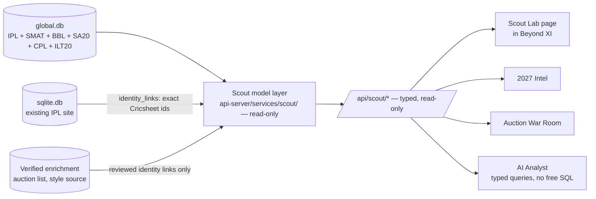

# Batch 1 report — Global Cricket Data Engine

Date: 2026-10-10. Scope, as approved:

- **Downloaded:** Cricsheet archives for IPL (comparison only), SMAT, BBL, SA20, CPL and ILT20, plus the people register.
- **Built:** a separate `global.db` with identity, metrics and validation.
- **Not touched:** the website, its routes and API, and `sqlite.db`.
- **Not started:** Batch 2. No git commit has been made and nothing has been deployed.

Detailed generated reports are in `lib/cricket-data/global/reports/`:

- `validation-2026-10-10.md`
- `identity-2026-10-10.md`
- `bench-2026-10-10.md`
- `change-*.md`

## 1. Downloads and coverage

All files came from the URLs on <https://cricsheet.org/downloads/> and <https://cricsheet.org/register/>.

- Every archive passed a CRC-32 check on every entry.
- Archives and SHA-256 hashes are recorded in `manifests/acquisitions.jsonl`.
- A second sync returned HTTP 304 (not modified) for all eight files, so nothing was downloaded twice.

| Competition | Archive (Last-Modified 7 Oct 2026) | Size | Matches | Seasons | Dates |
|---|---|---:|---:|---|---|
| IPL | `ipl_json/20261007T170516Z_5757e042.zip` | 4.95 MB | 1,243 | 2007/08 – 2026 (19) | 2008-04-18 – 2026-05-31 |
| Syed Mushtaq Ali Trophy | `sma_json/20261007T170607Z_8e4e376e.zip` | 2.58 MB | 695 | 2015/16, 2017/18 – 2024/25 (9) | 2016-01-02 – 2024-12-15 |
| Big Bash League | `bbl_json/20261007T170410Z_7946b113.zip` | 2.58 MB | 662 | 2011/12 – 2025/26 (15) | 2011-12-16 – 2026-01-25 |
| SA20 | `sat_json/20261007T170600Z_d9a9ec2d.zip` | 0.51 MB | 130 | 2022/23 – 2025/26 (4) | 2023-01-10 – 2026-01-25 |
| Caribbean Premier League | `cpl_json/20261007T170508Z_4b2f090b.zip` | 1.75 MB | 445 | 2013 – 2026 (14) | 2013-07-30 – 2026-09-20 |
| ILT20 | `ilt_json/20261007T170514Z_3d3776c3.zip` | 0.56 MB | 134 | 2022/23 – 2025/26 (4) | 2023-01-13 – 2026-01-04 |
| People register | `register/people/…_b946d3ab.csv` | 1.13 MB | 18,623 people | | |
| Name variants | `register/names/…_cde5292c.csv` | 0.15 MB | 7,551 names | | |

Matches per season:

- **IPL:** 2007/08 58 · 2009 57 · 2009/10 60 · 2011 73 · 2012 74 · 2013 76 · 2014 60 · 2015 59 · 2016 60 · 2017 59 · 2018 60 · 2019 60 · 2020/21 60 · 2021 60 · 2022 74 · 2023 74 · 2024 71 · 2025 74 · 2026 74
- **SMAT:** 2015/16 83 · 2017/18 79 · 2018/19 130 · 2019/20 131 · 2020/21 92 · 2021/22 89 · 2022/23 44 · 2023/24 39 · 2024/25 8
- **BBL:** 2011/12 27 · 2012/13 28 · 2013/14 34 · 2014/15 34 · 2015/16 32 · 2016/17 35 · 2017/18 43 · 2018/19 59 · 2019/20 61 · 2020/21 61 · 2021/22 60 · 2022/23 61 · 2023/24 41 · 2024/25 42 · 2025/26 44
- **SA20:** 33 · 33 · 33 · 31
- **CPL:** 2013 23 · 2014 27 · 2015 32 · 2016 29 · 2017 34 · 2018 33 · 2019 34 · 2020 33 · 2021 33 · 2022 31 · 2023 32 · 2024 34 · 2025 32 · 2026 38
- **ILT20:** 32 · 34 · 34 · 34

## 2. Match and delivery counts

| Competition | Matches | Deliveries | Innings | Super-over innings | D/L or VJD results | No result | Reviews | Substitutions (impact player) |
|---|---:|---:|---:|---:|---:|---:|---:|---:|
| IPL | 1,243 | 295,732 | | 34 | 23 | 9 | 990 | 624 (557) |
| SMAT | 695 | 158,839 | | 10 | 5 | 4 | 29 | 134 (113) |
| BBL | 662 | 153,250 | | 8 | 32 | 11 | 205 | 76 (0) |
| SA20 | 130 | 29,020 | | 2 | 5 | 7 | 278 | 6 (0) |
| CPL | 445 | 103,717 | | 4 | 30 | 7 | 400 | 27 (0) |
| ILT20 | 134 | 31,407 | | 2 | 0 | 1 | 294 | 202 (199) |
| **Total** | **3,309** | **771,965** | **6,648** | 60 | 95 | 39 | 2,196 | 1,069 (869) |

Everything in the files is preserved. Normalized rows across Batch 1:

| Rows | Count |
|---|---:|
| Innings | 6,648 |
| Powerplay windows | 7,162 |
| Wickets | 39,972 |
| Fielder credits (583 by substitutes) | 29,663 |
| Squad entries (`info.players`) | 73,743 |
| Reviews | 2,196 |
| Substitutions | 1,069 |

**Schema drift: zero.** Every JSON key in all 3,309 files is mapped to a column. The `extra` columns exist for future format changes and are empty.

## 3. Database size and performance

| Item | Value |
|---|---|
| `global.db` (after VACUUM) | **64.7 MB**: 88 bytes per delivery, including every table and index |
| Raw archives and registers kept | 14.2 MB. The archives alone are 12.9 MB and hold 263.8 MB of JSON; nothing is extracted to disk. |
| Full rebuild from the stored archives | **27 s** in a fresh database, identical to the incremental build on every table. The first build, run as separate step commands in the repo folder, took about 50 s in total: normalize 24.7 s, aggregate 9.1 s, identity ~4 s, validate ~12 s. |
| Sync with no changes | 16 s end to end; the ingest step itself takes about 0.15 s |
| Opening a read-only connection | ~1–2 ms |
| Cross-league player profile (every competition × season, batting + bowling) | 0.2 ms warm / 0.7 ms first |
| SMAT strike-rate leaderboard, ≥120 balls | ~3 ms |
| Middle-overs bowlers in SMAT + SA20 + BBL, ≥120 legal balls, by economy | ~3 ms |
| Every delivery faced by one player (index lookup) | ~5 ms |
| Process memory after these queries | 81 MB RSS |

Comparison with the existing IPL stack, measured during the audit:

- The site's in-memory column store takes 4.0 s and 117 MB RSS to build for IPL alone.
- `global.db` needs no warm-up: queries read precomputed aggregates or use indexes.
- Its IPL portion is roughly 25 MB of the 64.7 MB (a proportional share), against 53 MB for `sqlite.db`'s deliveries table and indexes. It also keeps the fielders, substitutions, reviews and powerplays that `sqlite.db` drops.

## 4. Players and cross-league identity

- **Players in loaded matches:** 2,720. All of them have a Cricsheet registry id present in the people register, and no name lacked an id.
- **External ids (from `people.csv`) for those players:**

  | Source | Players |
  |---|---:|
  | cricinfo | 2,720 |
  | bcci | 1,310 |
  | cricketarchive | 822 |
  | pulse | 820 |
  | nvplay | 245 |
  | bigbash | 179 |

| Players appearing in … | Count |
|---|---:|
| 1 competition | 1,990 |
| 2 competitions | 519 |
| 3 competitions | 127 |
| 4 competitions | 62 |
| 5 competitions | 22 |

IPL players who also appear in each other competition:

| Competition | IPL players |
|---|---:|
| SMAT | 320 |
| BBL | 203 |
| CPL | 168 |
| ILT20 | 115 |
| SA20 | 103 |

The largest non-IPL overlaps are BBL + CPL (128) and CPL + ILT20 (119).

Players in five competitions (squad appearances):

| Player | Cricsheet id | IPL | BBL | SA20 | CPL | ILT20 |
|---|---|---:|---:|---:|---:|---:|
| KA Pollard | a757b0d8 | 189 | 21 | 12 | 141 | 35 |
| SP Narine | 9d430b40 | 201 | 12 | 4 | 134 | 41 |
| Rashid Khan | 5f547c8b | 153 | 69 | 29 | 27 | 7 |
| TH David | f1f99156 | 66 | 80 | 3 | 34 | 15 |

The full list of 22 is in the identity report.

**Safeguards confirmed on real data:**

- **Same name, different people:** the same written name is used by different people in 11 cases, for example two "Yuvraj Singh" and two "Amit Mishra". They stay separate.
- **Same person, different names:** 6 people appear under two written names. They are joined by id, for example "NA Saini" / "Navdeep Saini".

**IPL warehouse bridge (`sqlite.db`, read-only):**

- 964 of 1,141 warehouse players are linked exactly by Cricsheet id.
- The other 177 have synthetic `json:N` ids. They are squad-only players who have never faced or bowled a ball.
- All 177 are in the review queue, unlinked: 59 have exact-name candidates and 118 have none.
- One example: warehouse "Wanindu Hasaranga" is a candidate for `a97c8ec2 PWH de Silva`, through a `names.csv` variant. It is waiting for review.

*Correction to the audit:* it reported 1,119 and 22. The ids had been counted by length, and `json:NNN` is also 8 characters. The audit document has been corrected.

## 5. Validation results

**118 checks pass, 2 warn, 0 fail.** Per competition:

1. **Match counts agree** across the catalogue page, archive, archive README and database.
2. **Format:** every match is male, club and 6-ball.
3. **Delivery arithmetic:** total = batter + extras, and extras = sum of the extra types.
4. **Over structure:** all 8 seven-ball overs in the data are ones the file itself marks in `miscounted_overs`.
5. **Innings length** is within the scheduled overs.
6. **Wickets** per innings are within the limits.
7. **Win-by-runs margins** equal the computed totals.
8. **Win-by-wickets margins** equal 10 minus wickets lost.
9. **Winning chases** reach the target.
10. **Ties** have equal totals.
11. **Full-length chase targets** equal the first innings plus 1. That is 2,559 targets in all. 27 targets set over reduced overs with no method recorded (rain-shortened matches) were skipped.
12. **References:** no orphan players.
13. **Registry:** every squad player is in the register.

The two warnings are both SMAT coverage, and both are facts about the source:

| Warning | Detail |
|---|---|
| Missing season | 2016/17 has no matches on Cricsheet |
| Thin recent seasons | 2022/23 has 44 matches, 2023/24 has 39 and 2024/25 has 8. Earlier seasons have 79–131, and nothing after 15 Dec 2024 is present. |

## 6. IPL: current Cricsheet archive vs the existing warehouse

- **Matches:** 1,243 on both sides, with the same ids.
- **Match level:** 0 differences across balls, runs, batter runs, extras, wides, no-balls, wickets, innings, winner, toss winner and venue. No Cricsheet revision since the warehouse build changed any figure.
- **Player-season level** (3,337 player-seasons, super overs excluded on both sides):
  - Runs, balls faced, dismissals, legal balls and bowler wickets **agree exactly**.
  - **Runs conceded differ in 1,485 player-seasons, all for one reason:**
    - The existing site's modules compute conceded runs as `total_runs` minus extras when `is_bye`, `is_legbye` or `is_penalty` is set. In `sqlite.db` those three flags are 0 on every row.
    - So the site has been charging byes, leg-byes and penalty runs to bowlers. The warehouse side is higher by 7,142 runs, exactly the bye, leg-bye and penalty runs in the source outside super overs.
    - This affects IPL economy figures on the existing site, including Advanced Stats, Squad DNA, player profiles and the weakness detector.
    - `global.db` uses the correct definition. As instructed, **the existing site was not changed**. The fix belongs to the separate website phase: either backfill the three flags in `sqlite.db` or change the conceded expression.

## 7. Missing metadata and limitations

| Area | Status |
|---|---|
| Bowling style (pace/spin, arm), batting hand | **Not in Cricsheet.** Absent from `global.db`. The existing IPL-only style data (`players-data-updated.csv`, 772 players) is not merged; it would need reviewed identity links. |
| Nationality, date of birth, capped status | Not in Cricsheet. The 2026 auction list in the repo has these for about 398 listed players, but by name only, so it needs reviewed identity links before use. |
| SMAT coverage | 2016/17 missing; 2022/23 – 2024/25 thin; nothing after Dec 2024. This is the main gap for uncapped-Indian scouting, and no state T20 leagues (TNPL etc.) are on Cricsheet. |
| Venues | Only 3 CPL 2026 files carry Cricsheet venue ids (format 1.3.0). The other 182 venues are keyed by name + city, so one ground can appear under two names. There are 185 venue rows; venue aliasing is not done. |
| Team renames | Only the 4 IPL renames already mapped by the project are aliased. Renames in CPL, BBL and other leagues are kept as separate team rows. |
| Officials | Missing on 603 of 695 SMAT matches; the files say umpires are missing. |
| Fielders | Named on 94–100% of catches, stumpings and run-outs, depending on competition (CPL 94%, BBL 97.2%). |
| Keepers | Not labelled. Only stumpings imply them. |
| Ball tracking, line/length, shot location, speed | Not in Cricsheet. |
| Identity review | 177 IPL warehouse squad-only players are unlinked until reviewed. |
| Not built yet | Derived roles, within-role percentiles, league-relative indices, similarity and franchise fit. These are scouting-model decisions and belong to the Scout Lab phase (§9). The counts they need are in place. |

## 8. Final directory structure

```
lib/cricket-data/global/
├─ raw/cricsheet/                       (gitignored, 14.2 MB)
│  ├─ archives/{ipl,sma,bbl,sat,cpl,ilt}_json/<lastModified>_<sha8>.zip
│  └─ register/{people,names}/<lastModified>_<sha8>.csv
├─ manifests/                           (tracked, 37 KB)
│  ├─ sources.json  acquisitions.jsonl  coverage.json  team-aliases.json  identity-decisions.json
├─ warehouse/global.db                  (gitignored, 64.7 MB)
└─ reports/                             (tracked) validation-*, identity-*, bench-*, change-*
scripts/src/global/
├─ paths.ts  zip.ts  acquire.ts  schema.sql  db.ts  normalize.ts  csv.ts  identity.ts
├─ metrics.ts  aggregate.ts  validate.ts  sync.ts  onboard.ts  bench.ts
└─ tests/metrics.test.ts  tests/pipeline.test.ts         (12 tests, all passing)
docs/global-data-engine/
├─ 00-audit-and-plan.md  01-batch-1-report.md  README.md  metrics.md  identity.md
```

**Modified:**

- `scripts/package.json`: `global:*` and `test:global` scripts, plus the `fflate` dependency.
- `pnpm-lock.yaml`: the one `fflate` entry.
- `.gitignore`: `lib/cricket-data/global/raw/` and `lib/cricket-data/global/warehouse/`.

**Untouched:**

- `sqlite.db` and its WAL; the last write is still 28 Jul 2026.
- `ipl_csv/`, `lib/cricket-data/raw/`, `lib/cricket-data/aggregated/`.
- `artifacts/api-server/**`, `artifacts/ipl-analytics/**`.

## 9. Commands

Update everything that changed upstream:

```bash
pnpm --filter @workspace/scripts run global:sync
```

Rebuild from the stored archives (no network):

```bash
pnpm --filter @workspace/scripts run global:build
```

Run the tests:

```bash
pnpm --filter @workspace/scripts run test:global
```

Measure size and query speed:

```bash
pnpm --filter @workspace/scripts run global:bench -- --vacuum
```

[README.md](README.md) covers per-step commands, `--only` and `--force`, and onboarding a competition.

## 10. Proposed architecture: Scout Lab and Global Talent Radar



**1. Scout model layer.** Backend only and read-only on `global.db`, using the definitions in `metrics.ts`.

| Part | What it does |
|---|---|
| Profile | Career by competition, season and phase, with sample tier, Wilson intervals, and a league-relative index (player rate ÷ the competition baseline for the same season and phase). |
| Derived roles (versioned rules) | Batting slot from order of arrival at the crease; share of balls faced by phase; overs per match and phase share when bowling; keeper flag from stumpings. Stored in a `player_roles` table with the rule version, and labelled "derived". |
| Percentiles | Within competition × derived role × recent window (for example the last two seasons), rankable samples only. |
| Comparable players | Nearest neighbours on baseline-normalised phase rates, within the same role. |
| Development trend | Recent seasons against the player's own history, shrunk toward the role mean so a 35-ball hot streak cannot outrank 600 balls. |

**2. Franchise fit.**

- Squad role gaps come from the existing IPL tools: Squad DNA and the 2027 squads in `sqlite.db`, joined through `identity_links`.
- Every recommendation lists its inputs, weights and uncertainty.
- **Validation before launch:** players who moved into the IPL from SMAT, BBL, CPL, SA20 or ILT20 form a backtest set (320 SMAT → IPL players alone). The model is checked on how well it predicted their actual IPL output. Until that is published, the fit score stays labelled experimental.

**3. Eligibility layer, kept separate.**

- Capped status, country and auction availability come only from official lists, such as the 2026 auction list already in the repo.
- They are linked through reviewed identity decisions and never inferred from playing in a league.

**4. Enrichment needed before some queries work.**

- **Pace/spin and arm style.** Without these, a query like "middle-overs spin bowlers across SMAT, SA20 and BBL" cannot classify non-IPL bowlers. Options:
  - (a) the auction list's bowling-style column, for listed players only;
  - (b) a licensed or permitted source joined on `key_cricinfo`;
  - (c) a curated table for shortlisted players, with a source cited per row.
- Until then, the page should say "bowling type unknown", not guess.

**5. Readiness of the three test queries you proposed:**

| Query | Ready? | Notes |
|---|---|---|
| Cross-league player profile | **Ready now** | 0.2 ms |
| Emerging talent | **Statistics ready** | Uncapped status needs the eligibility layer above. Until then, results are labelled "capped status unverified". |
| Franchise scouting for middle-overs spinners | **Partial** | Middle-overs bowling metrics are ready across all three leagues. Spin classification needs enrichment (option a or c). |

**6. Proposed sequence (each step needs your approval):**

1. Scout model layer and `/api/scout/*`, with tests (backend only).
2. The three demonstration queries, run against it.
3. Fixing the 34 MB player-page download and the conceded-runs discrepancy on the existing site.
4. The Scout Lab page.
5. Franchise fit with the published backtest.
6. Batch 2 downloads, after you review this report.
