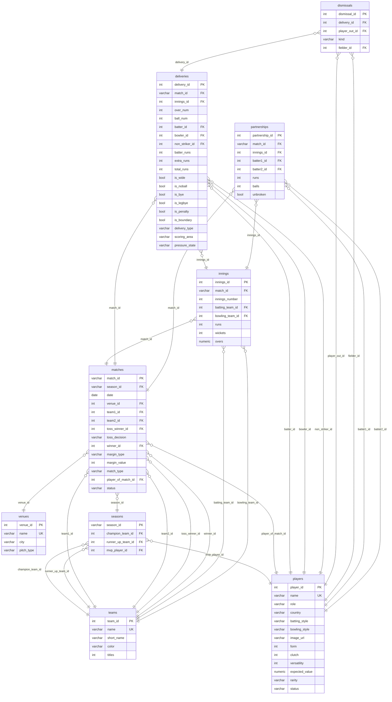

# Entity Relationship Diagram (ERD)

This document maps out the foreign key relationships and schema definitions of the normalized IPL cricket analytics relational database backend.

## Mermaid Schema Diagram

## Relational Constraints & Cascades

### 1. Cascade Deletes
To ensure referential integrity during imports and cleanup:
* **`innings`**: cascade delete when `matches` is deleted (`ON DELETE CASCADE`).
* **`deliveries`**: cascade delete when `matches` or `innings` is deleted.
* **`dismissals`**: cascade delete when `deliveries` is deleted.
* **`partnerships`**: cascade delete when `matches` or `innings` is deleted.

### 2. Nullable References (Set Null)
To prevent foreign key constraints from blocking dimension cleanups:
* **`seasons`**: setting null on `champion_team_id`, `runner_up_team_id`, and `mvp_player_id` if a team/player is deleted.
* **`matches`**: setting null on `winner_id` or `player_of_match_id`.
* **`dismissals`**: setting null on `fielder_id` if the fielder's player record is removed (e.g. sub fielder).
